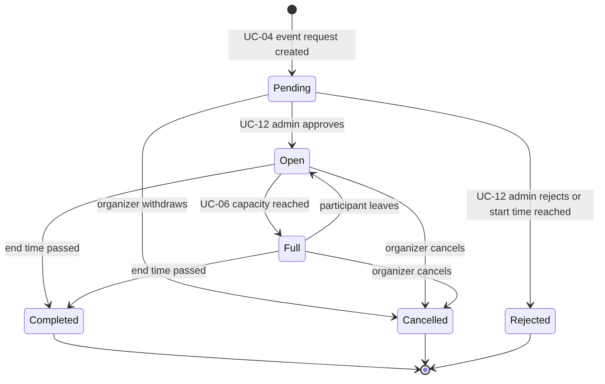

# CR-01: Admin Approval of Event Requests

| Field | Value |
|---|---|
| **ID** | CR-01 |
| **Date** | 17.11.2026 |
| **Status** | Proposed (team review in the pull request) |
| **New use case** | [UC-12 Review event requests](../requirements/UC-12_review_event_requests.md) |
| **Changed use cases** | UC-04, UC-05, UC-06, UC-07, UC-11 |

## 1. Motivation
Until now an event was public as soon as a student created it (UC-04). Nobody could stop an inappropriate or rule-breaking event before other students saw and joined it. CR-01 adds an **Admin** who approves or rejects every new event before it is published.

## 2. How similar platforms do it
The workflow follows the platforms that universities already use for student events:

| Platform | What we took from it |
|---|---|
| CampusGroups (Ready Education) | An event that waits for approval has the status *Pending Approval* and does **not** appear in the event list or calendar; after approval the audience can see it and RSVP. Pending room reservations are shown in the room schedule as *pending/tentative*. |
| Anthology Engage | Submission managers approve or **deny** pending submissions; after a denial the organizer can update the details and **resubmit**, which creates a new pending submission. |
| Planning Center Calendar | A new request that **conflicts with a pending request** is detected; pending events are shown to approvers and hidden from everyone else. |
| Accelevents | The organizer gets an **e-mail for every status** of the proposal (pending, denied, approved). |

Sources: [CampusGroups – simple event approval](https://help.campusgroups.com/articles/2064765-how-to-set-up-a-simple-event-approval), [CampusGroups – rooms module](https://helpcenter.readyeducation.com/cg-rooms-module), [Anthology Engage – managing event submissions](https://help.anthology.com/engage/en/managing-event-submissions.html), [Planning Center – manage event requests](https://help.planningcenter.com/en/manage-event-requests.html), [Accelevents – approval workflow](https://support.accelevents.com/en/articles/11687929-approval-workflow-for-events).

## 3. Decisions
| # | Question | Decision | Reason |
|---|---|---|---|
| D-1 | Is a new event visible before approval? | No. New events start as **Pending** and are not listed or joinable (BR-15). | CampusGroups |
| D-2 | Does a pending request hold the facility slot? | Yes (BR-16). A rejection, withdrawal or expiry frees it. | CampusGroups shows pending reservations in the schedule; without this, two requests for the same slot could both be approved. |
| D-3 | Who reviews? | A new role **Admin** (e.g. student affairs), separate from Facility Staff. Assigned like Facility Staff (assumption A-04). | Facility staff manage rooms; deciding on event content is a different responsibility (separation of duties). |
| D-4 | What does a rejection need? | A reason is required; organizer, reviewer and time are stored (BR-17). | Engage, Accelevents; the organizer needs to know what to fix, and decisions stay traceable. |
| D-5 | Can a rejected event be fixed? | The organizer submits a corrected request with UC-04. A rejected event itself is final. | Engage resubmission, kept simple: no edit feature needed. |
| D-6 | What if nobody reviews in time? | A request still pending at its start time is rejected automatically, without a reviewer (BR-18). | The event can no longer take place; the slot must not stay blocked. |
| D-7 | Can the organizer withdraw a pending request? | Yes, with Cancel (UC-11). | Same action as cancelling an approved event. |
| D-8 | Is the organizer informed? | Yes, an e-mail for approval and for rejection (with the reason). | Accelevents |

## 4. New event life cycle

## 5. Impact
| Area | Change |
|---|---|
| Requirements | New actor Admin, new [UC-12](../requirements/UC-12_review_event_requests.md); UC-04, UC-05, UC-06, UC-07, UC-11 updated; BR-15 to BR-18; use case diagram; [specification](../requirements_specification.md) (actors, A-04, NFR-04, traceability) |
| Analysis | Event state diagram, E-R diagram, domain model, UC-04 sequence, data dictionary, business rules ([report](../requirement_analysis_report.md), revision note in section 9) |
| Design | `Role.ADMIN`, `EventStatus.PENDING/REJECTED`, review fields on `Event`, five new `EventService` methods, `EmailSender.send_event_decision`, `EventRepository.pending()/organized_by()`, architecture diagram, new sequence 5.7, data design, traceability ([report](../software_design_report.md), revision note in section 11) |
| Database | `user.role` accepts `admin`; `event.status` default `pending` and accepts `pending`/`rejected`; new columns `event.reviewed_by` (FK → `user.id`, nullable), `event.reviewed_at`, `event.rejection_reason`; check that a rejected event has a reason; partial index on pending events by start time |
| Code skeleton | [`models.py`](../../src/campusevent/models.py), [`events.py`](../../src/campusevent/events.py), [`notifications.py`](../../src/campusevent/notifications.py) |
| Tests | New [`test_uc12_review_event_requests.py`](../../tests/test_uc12_review_event_requests.py) (9 tests), new NFR-04 test; UC-04, UC-05, UC-11 and NFR-02 tests adapted (events are approved in the test setup). Total: 51 tests, all failing by design until implemented. |
| UI (open) | An *Event Requests* page for admins and status labels (Pending / Rejected + reason) on *My Activities* still need mockups. |
| Plan (open) | UC-12 belongs to task 3.4 (backend events) and 3.6 (web UI events); the team decides whether the dates change. |
