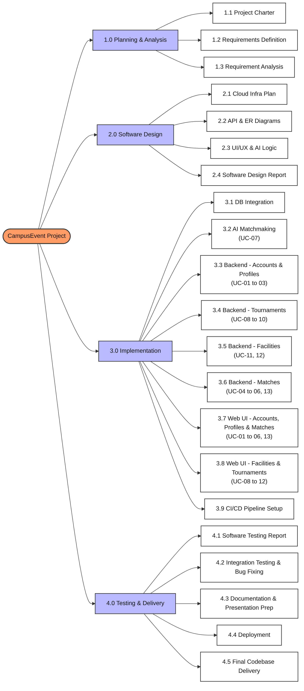
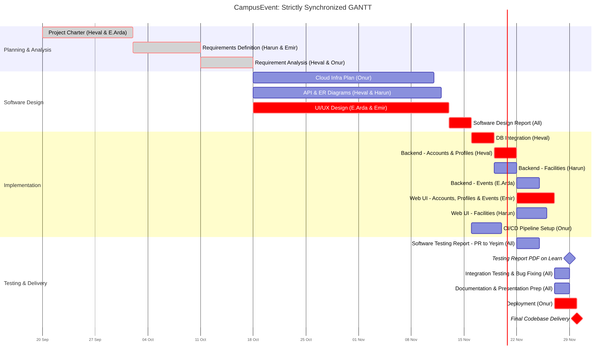
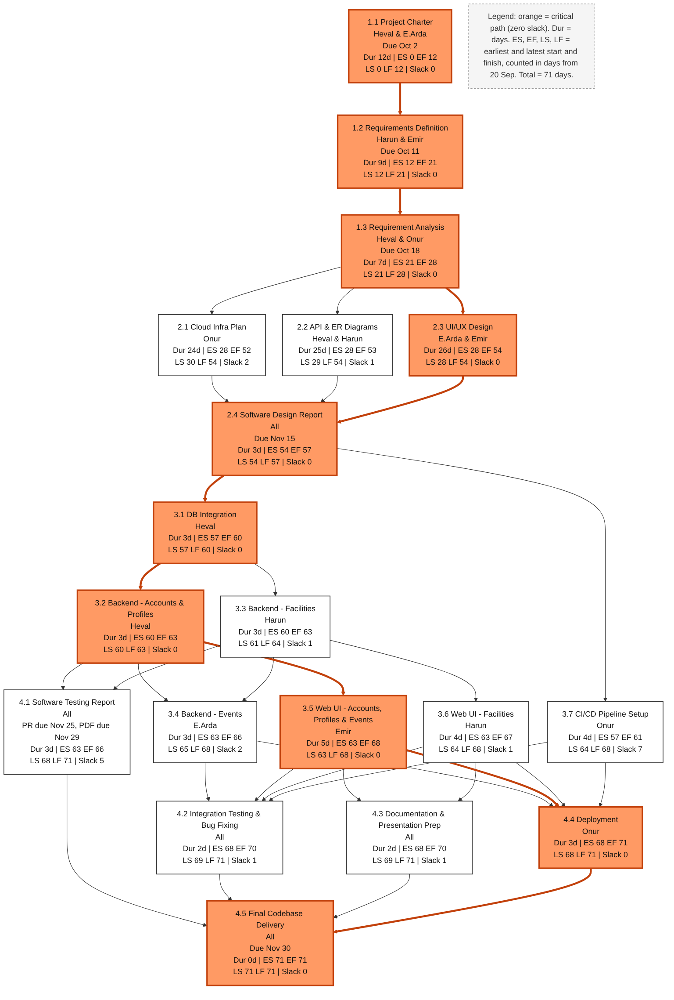

# CampusEvent – Project Plan Documents

| Document | File |
|---|---|
| Project Charter | [../CHARTER.MD](../CHARTER.MD) |
| Work Breakdown Structure (WBS) | [WBS_Diagram.pdf](WBS_Diagram.pdf) · [PNG](WBS_Diagram.png) · [source](wbs_diagram.mmd) |
| Gantt chart | [gantt_chart.pdf](gantt_chart.pdf) · [PNG](gantt_chart.png) · [source](gantt_chart.mmd) |
| PERT chart | [pert_chart.pdf](pert_chart.pdf) · [PNG](pert_chart.png) · [source](pert_chart.mmd) |

The WBS, the Gantt chart and the PERT chart show the same 19 tasks, owners and dates (the Gantt chart also marks the deadline of the Testing Report PDF). The charts are drawn with Mermaid from the `.mmd` source files. To change a chart, edit its `.mmd` file and render it again.

## Work Breakdown Structure (WBS)
The project is split into four work packages: 1.0 Planning & Analysis, 2.0 Software Design, 3.0 Implementation and 4.0 Testing & Delivery. Every use case (UC-01 to UC-11) is covered by a backend task and a web UI task in 3.0.

## Task List
Dates are 2026. Days are calendar days. Slack is the number of days a task can be late without delaying the final delivery.

| ID | Task | Owner | Start | End | Days | Slack | Critical |
|---|---|---|---|---|---|---|---|
| 1.1 | Project Charter | Heval & E.Arda | 20 Sep | 02 Oct | 12 | 0 | **yes** |
| 1.2 | Requirements Definition | Harun & Emir | 02 Oct | 11 Oct | 9 | 0 | **yes** |
| 1.3 | Requirement Analysis | Heval & Onur | 11 Oct | 18 Oct | 7 | 0 | **yes** |
| 2.1 | Cloud Infra Plan | Onur | 18 Oct | 11 Nov | 24 | 2 |  |
| 2.2 | API & ER Diagrams | Heval & Harun | 18 Oct | 12 Nov | 25 | 1 |  |
| 2.3 | UI/UX Design | E.Arda & Emir | 18 Oct | 13 Nov | 26 | 0 | **yes** |
| 2.4 | Software Design Report | All | 13 Nov | 16 Nov | 3 | 0 | **yes** |
| 3.1 | DB Integration | Heval | 16 Nov | 19 Nov | 3 | 0 | **yes** |
| 3.2 | Backend - Accounts & Profiles (UC-01 to 03) | Heval | 19 Nov | 22 Nov | 3 | 0 | **yes** |
| 3.3 | Backend - Facilities (UC-07, 08) | Harun | 19 Nov | 22 Nov | 3 | 1 |  |
| 3.4 | Backend - Events (UC-04 to 06, 09 to 11) | E.Arda | 22 Nov | 25 Nov | 3 | 2 |  |
| 3.5 | Web UI - Accounts, Profiles & Events (UC-01 to 06, 09 to 11) | Emir | 22 Nov | 27 Nov | 5 | 0 | **yes** |
| 3.6 | Web UI - Facilities (UC-07, 08) | Harun | 22 Nov | 26 Nov | 4 | 1 |  |
| 3.7 | CI/CD Pipeline Setup | Onur | 16 Nov | 20 Nov | 4 | 7 |  |
| 4.1 | Software Testing Report (pull request to Yeşim by 25 Nov, PDF on Learn by 29 Nov) | All | 22 Nov | 25 Nov | 3 | 5 |  |
| 4.2 | Integration Testing & Bug Fixing | All | 27 Nov | 29 Nov | 2 | 1 |  |
| 4.3 | Documentation & Presentation Prep | All | 27 Nov | 29 Nov | 2 | 1 |  |
| 4.4 | Deployment | Onur | 27 Nov | 30 Nov | 3 | 0 | **yes** |
| 4.5 | Final Codebase Delivery | All | 30 Nov | 30 Nov | 0 | 0 | **yes** |

**Change of 20 Nov (task 4.1):** the instructor moved the Software Testing Report one week later (course announcement of 17 Nov). The pull request, with Yeşim as reviewer, is due on **25.11.2026**; after it is approved, the PDF goes to Learn by **29.11.2026**. Besides the test results, the report now needs a traceability matrix with code and requirements coverage (`docs/tests/coverage`), the non-functional tests and their results (`docs/tests/non-func-tests`) and a SonarQube analysis with a plan for the high severity issues (`docs/tests/quality`). 4.1 still starts on 22 Nov, after the backend of accounts, profiles and facilities; the events backend (3.4) ends on the day of the pull request. The critical path does not change.

## Gantt Chart
Red bars are on the critical path.

## PERT Chart
Each task shows its duration (Dur), earliest start and finish (ES, EF), latest start and finish (LS, LF) and slack, counted in days from 20 September. Highlighted (orange) tasks have zero slack and form the critical path:

1.1 Project Charter → 1.2 Requirements Definition → 1.3 Requirement Analysis → 2.3 UI/UX Design → 2.4 Software Design Report → 3.1 DB Integration → 3.2 Backend: Accounts & Profiles → 3.5 Web UI: Accounts, Profiles & Events → 4.4 Deployment → 4.5 Final Codebase Delivery

12 + 9 + 7 + 26 + 3 + 3 + 3 + 5 + 3 = **71 days** (20 Sep to 30 Nov)

Any delay on these tasks delays the final delivery. The other tasks have between 1 and 7 days of slack.

