# CampusEvent – Requirement Analysis Report

**Course:** CMPE 331 – Software Engineering
**Group:** 14
**Team:** Heval Hüseyin Demir, Emre Arda Kum, Emir Gül, Harun Gündaş, Onur Alioğlu
**Repository:** https://github.com/emir-heval-arda-harun/CMPE-331-project
**Version:** 1.2 – 16.10.2026 (scope generalized to all event types) (deadline 18.10.2026 23:59)

---

## 1. Introduction

### 1.1 Purpose
The [Requirements Specification](requirements_specification.md) states **what** CampusEvent must do in 11 use cases (UC-01 to UC-11). CampusEvent is a platform for events of **any kind** (sports, study groups, game nights, club meetings and more); the category of an event is free text. This report **analyzes** the requirements. It builds the conceptual and data models, shows how the system behaves in the important scenarios, collects the business rules, and lists the gaps and risks found in the requirements. The Software Design Report will take these results as its input.

### 1.2 Method
Each use case was read together with the domain classes in [`src/campusevent/models.py`](../src/campusevent/models.py). From them we derived:

1. a conceptual class model, business process diagrams (BPD) and data flow diagrams (DFD) (section 2),
2. a data model with an E-R diagram and data dictionary (section 3),
3. sequence and state diagrams for every use case (section 4),
4. a consolidated list of business rules (section 5),
5. open issues and risks with decisions (sections 6 and 7),
6. a consistency check between requirements and models (section 9) and preliminary UI mockups with a UI Spec Lite description (section 10).

All diagrams are also stored as separate files (Mermaid source, PNG, SVG) in [`analysis/`](analysis/README.md).

Items marked **(proposed)** are analysis proposals that are not part of a use case yet and will be decided during design. The decisions F-01 to F-04 and F-10 are already applied to the requirements and models (section 9).

### 1.3 Inputs
| Document | Location |
|---|---|
| Project Charter | [CHARTER.MD](CHARTER.MD) |
| Requirements Specification | [requirements_specification.md](requirements_specification.md) |
| Use cases UC-01 … UC-11 | [requirements/](requirements/README.md) |
| Domain classes | [`src/campusevent/models.py`](../src/campusevent/models.py) |

---

## 2. Conceptual Model

### 2.1 Actors and use-case relations
| Actor | Use cases |
|---|---|
| Student | UC-01 to UC-07, UC-09, UC-10, UC-11 (UC-04 and UC-11 as organizer) |
| Facility Staff | UC-02, UC-08 |
| E-mail service (external) | UC-01 |

Relations between use cases: UC-04 **includes** UC-07 (facility check). UC-06 **extends** UC-05 (join from the event list). UC-10 and UC-11 need an event created by UC-04.

### 2.2 Domain class model
The model below comes from `models.py` and is extended with the relations the use cases imply (`Participation`, `VerificationCode`, the facility capacity and the free-text category of an event).

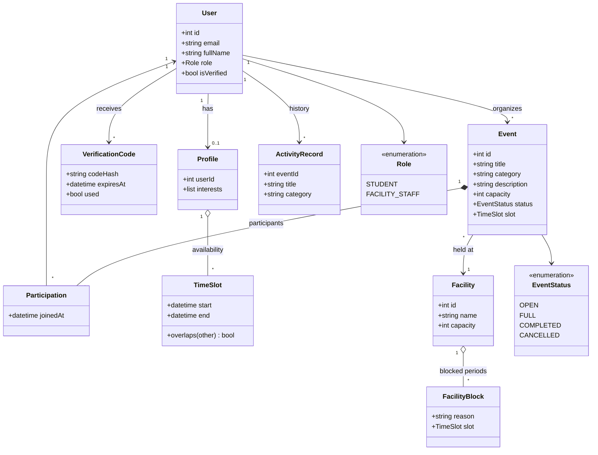

*Diagram files: [`domain_class_model.png`](analysis/data/domain_class_model.png), [source `domain_class_model.mmd`](analysis/data/domain_class_model.mmd)*

### 2.3 Glossary of analysis terms
| Term | Meaning |
|---|---|
| Busy slot | A time slot of a facility that is blocked by staff or already used by an active event |
| Free place | `capacity` minus the number of participants of an event |
| Category | Free-text label of an event or interest, e.g. "football", "study group"; trimmed and compared without regard to upper or lower case |
| Active event | An event with status Open or Full (it occupies its facility slot) |

### 2.4 Business process models (BPD)
The business process diagrams show who does what in the important processes. Each lane is an actor or the system; diamonds are decisions.

*Files: [png](analysis/process/bpd_account_onboarding.png), [svg](analysis/process/bpd_account_onboarding.svg)*

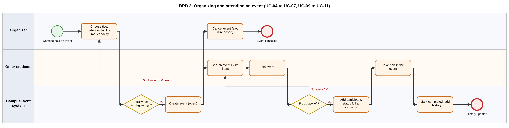
*Files: [png](analysis/process/bpd_event_lifecycle.png), [svg](analysis/process/bpd_event_lifecycle.svg)*

*Files: [png](analysis/process/bpd_facility_management.png), [svg](analysis/process/bpd_facility_management.svg)*

### 2.5 Data flow models (DFD)
The context diagram (level 0) shows CampusEvent as one process with its three external parties. Level 1 splits it into four processes and four data stores. E-mail addresses are only sent to the e-mail service and are never shown to other students (NFR-05).

*Files: [png](analysis/process/dfd_level0_context.png), [mermaid source](analysis/process/dfd_level0_context.mmd)*

*Files: [png](analysis/process/dfd_level1.png), [svg](analysis/process/dfd_level1.svg)*

| Process | Use cases | Data stores used |
|---|---|---|
| 1.0 Manage accounts and profiles | UC-01, UC-02, UC-03 | D1, D2 |
| 2.0 Manage events | UC-04, UC-05, UC-06, UC-10, UC-11 | D3, D4 |
| 3.0 Show activity history | UC-09 | D3 |
| 4.0 Manage facility schedule | UC-07, UC-08 | D4 |

---

## 3. Data Analysis

### 3.1 E-R diagram
The class model keeps interests as a list of strings. For a database they become a link table `PROFILE_INTEREST`; the category of an event stays a plain text column, because categories are free text (BR-14).

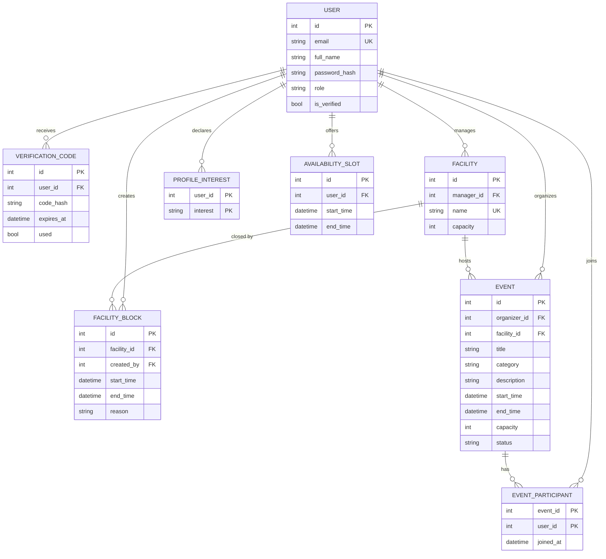

*Diagram files: [`er_diagram.png`](analysis/data/er_diagram.png), [source `er_diagram.mmd`](analysis/data/er_diagram.mmd)*

### 3.2 Data dictionary (main constraints)
| Entity | Constraint | Source |
|---|---|---|
| USER | `email` unique; domain must be `bilgiedu.net` or `bilgi.edu.tr`; `password_hash` is never plain text | UC-01, BR-01, BR-02 |
| USER | `role` is one of student, facility_staff | `Role` enum |
| PROFILE_INTEREST | One row per user and interest text; a profile needs at least one row; text is trimmed and stored in lower case | UC-03, BR-14 |
| AVAILABILITY_SLOT | `end_time` is after `start_time` | UC-03 alt. 5b |
| FACILITY | `manager_id` is a user with the facility staff role; `capacity` is at least 2 | UC-08, F-02 |
| FACILITY_BLOCK | `created_by` is the facility staff member who blocked the time; `end_time` is after `start_time`; blocks of one facility must not overlap each other | UC-08, BR-10 |
| EVENT | `title` and `category` are not empty; `category` is free text | UC-04, BR-14 |
| EVENT | `capacity` is at least 2 and at most the `capacity` of the facility | UC-04, BR-04, F-03 |
| EVENT | The time slot must not overlap any block or other active event of the same facility | UC-04, UC-07, BR-06 |
| EVENT | `status` is one of open, full, completed, cancelled | `EventStatus` enum |
| EVENT_PARTICIPANT | A user can join an event only once (composite key); number of rows is at most `capacity`; the organizer is the first row | UC-06, BR-05, BR-07 |

### 3.3 Design notes for the database
- **Integrity of facility use.** The rule "no two events share a facility at the same time" cannot be guaranteed by application code alone, because two students can book at the same moment. The database should enforce it (for example with a transaction and a row lock on the facility, or an exclusion constraint on the time range if the chosen database supports it).
- **Capacity.** Joining an event must count participants and insert the new row in one transaction. Otherwise two simultaneous joins can exceed `capacity`.
- **Category search.** Because categories are free text, the search normalizes them (trim, lower case) and can use a simple index on `category` and on `start_time`; this keeps NFR-02 (search under 2 seconds for 1,000 events) easy to reach.
- **Normal form.** All tables are in 3NF: link tables hold only key attributes and facts about the pair.
- **Time zone.** All times are stored in UTC and shown in Europe/Istanbul **(proposed)**.

---

## 4. Behavior Analysis

### 4.1 Sequence: register and verify (UC-01)
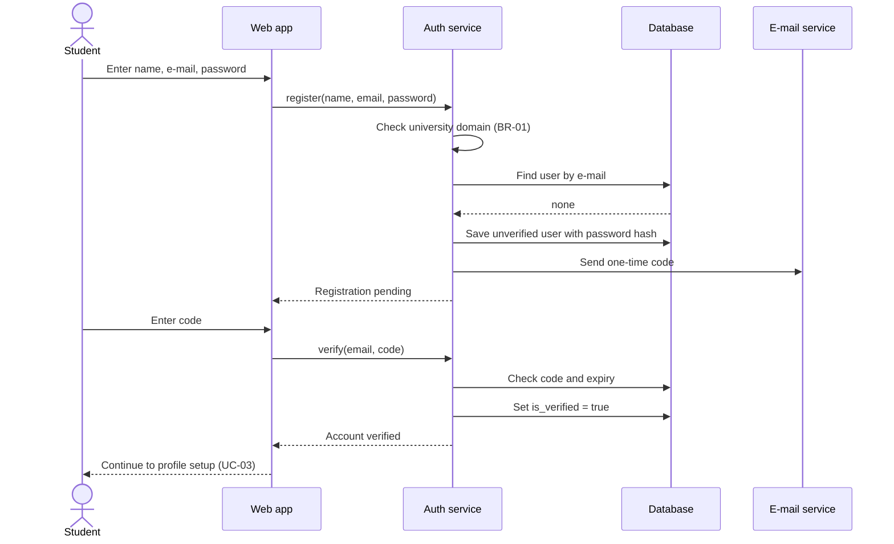

*Diagram files: [`sequence_uc01_register_verify.png`](analysis/behavior/sequence_uc01_register_verify.png), [source `sequence_uc01_register_verify.mmd`](analysis/behavior/sequence_uc01_register_verify.mmd)*

### 4.2 Sequence: create an event with conflict check (UC-04 and UC-07)
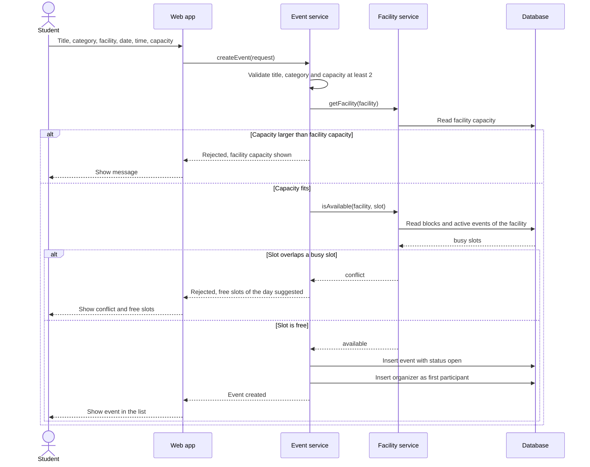

*Diagram files: [`sequence_uc04_uc07_create_event.png`](analysis/behavior/sequence_uc04_uc07_create_event.png), [source `sequence_uc04_uc07_create_event.mmd`](analysis/behavior/sequence_uc04_uc07_create_event.mmd)*
Analysis note: the availability check and the insert must run in **one transaction**; otherwise two students can both pass the check for the same slot.

### 4.3 Sequence: browse, filter and join events (UC-05 and UC-06)
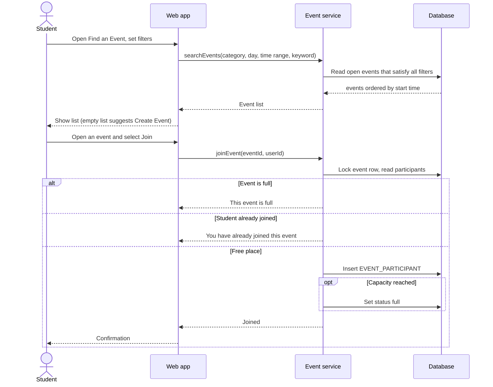

*Diagram files: [`sequence_uc05_uc06_browse_and_join_events.png`](analysis/behavior/sequence_uc05_uc06_browse_and_join_events.png), [source `sequence_uc05_uc06_browse_and_join_events.mmd`](analysis/behavior/sequence_uc05_uc06_browse_and_join_events.mmd)*

### 4.4 Sequence: leave and cancel an event (UC-10 and UC-11)
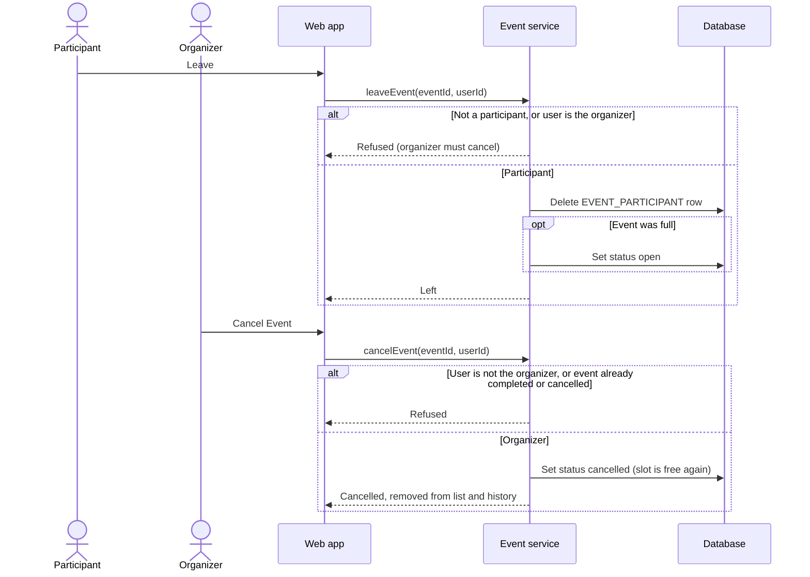

*Diagram files: [`sequence_uc10_uc11_leave_and_cancel.png`](analysis/behavior/sequence_uc10_uc11_leave_and_cancel.png), [source `sequence_uc10_uc11_leave_and_cancel.mmd`](analysis/behavior/sequence_uc10_uc11_leave_and_cancel.mmd)*

### 4.5 State diagrams

**Event** (UC-04, UC-06, UC-09, UC-10, UC-11). The transition to Completed happens automatically when the end time has passed.
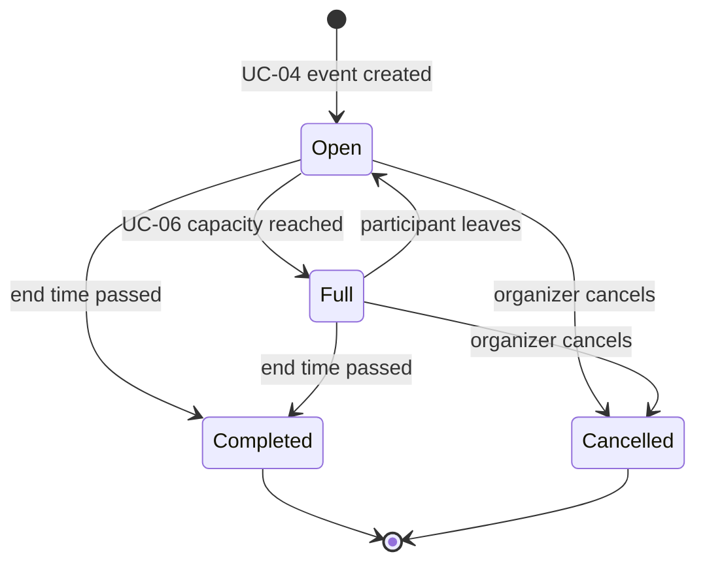

*Diagram files: [`state_event.png`](analysis/behavior/state_event.png), [source `state_event.mmd`](analysis/behavior/state_event.mmd)*

**User account** (UC-01, UC-02).
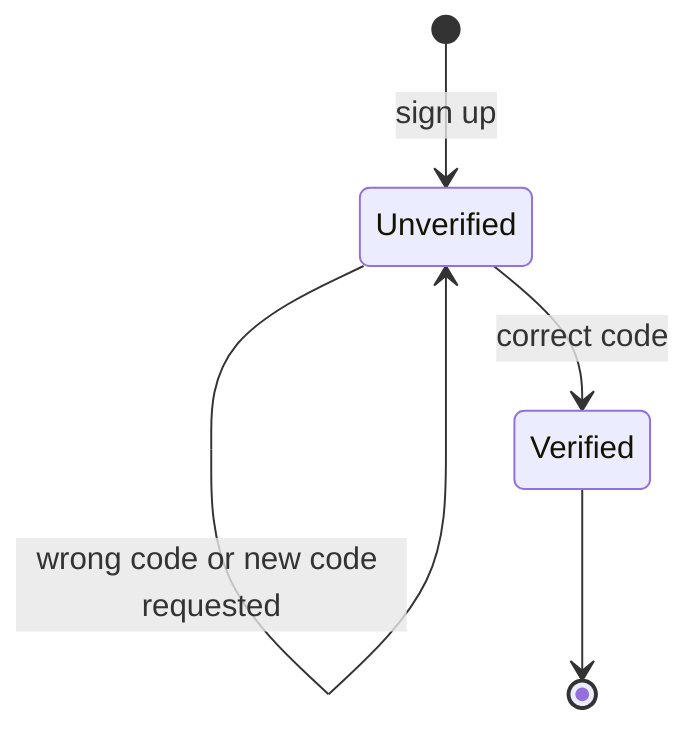

*Diagram files: [`state_user_account.png`](analysis/behavior/state_user_account.png), [source `state_user_account.mmd`](analysis/behavior/state_user_account.mmd)*
Only verified accounts can log in (UC-02 step 3).

### 4.6 Sequence diagrams of the remaining use cases

**UC-02 Log in**

*Files: [png](analysis/behavior/sequence_uc02_login.png), [source](analysis/behavior/sequence_uc02_login.mmd)*

**UC-03 Manage profile**

*Files: [png](analysis/behavior/sequence_uc03_manage_profile.png), [source](analysis/behavior/sequence_uc03_manage_profile.mmd)*

**UC-08 Manage facility schedule**

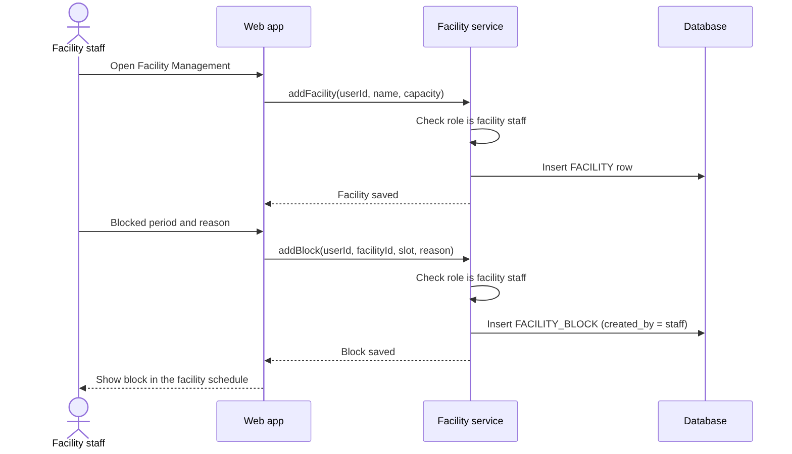
*Files: [png](analysis/behavior/sequence_uc08_manage_facility_schedule.png), [source](analysis/behavior/sequence_uc08_manage_facility_schedule.mmd)*

**UC-09 Track activity history**

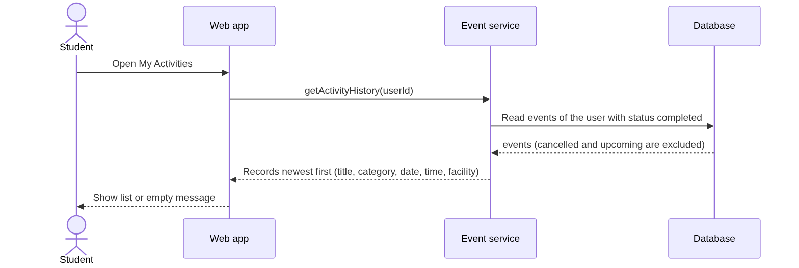
*Files: [png](analysis/behavior/sequence_uc09_activity_history.png), [source](analysis/behavior/sequence_uc09_activity_history.mmd)*

### 4.7 Behavior model coverage
Every use case has at least one behavioral model.

| Use case | Model |
|---|---|
| UC-01 | Sequence 4.1, account state 4.5, BPD 1 |
| UC-02 | Sequence 4.6, account state 4.5, BPD 1 |
| UC-03 | Sequence 4.6, BPD 1 |
| UC-04 | Sequence 4.2, event state 4.5, BPD 2 |
| UC-05, UC-06 | Sequence 4.3, event state 4.5, BPD 2 |
| UC-07 | Sequence 4.2, BPD 3 |
| UC-08 | Sequence 4.6, BPD 3 |
| UC-09 | Sequence 4.6, event state 4.5, BPD 2 |
| UC-10, UC-11 | Sequence 4.4, event state 4.5, BPD 2 |

---

## 5. Business Rules

| ID | Rule | Source |
|---|---|---|
| BR-01 | Only university e-mail domains are accepted | UC-01 |
| BR-02 | Passwords are never stored in plain text | UC-01 |
| BR-03 | Only verified users can log in **(derived)** | UC-02 |
| BR-04 | An event needs a capacity of at least 2 and at most the capacity of its facility **(derived)** | UC-04 |
| BR-05 | The organizer is the first participant of an event **(derived)** | UC-04 |
| BR-06 | No two active events or blocks may use the same facility at the same time **(derived)** | UC-07 |
| BR-07 | A user joins an event at most once, and never above capacity **(derived)** | UC-06 |
| BR-08 | An event becomes Full at capacity and Open again when a participant leaves **(derived)** | UC-06, UC-10 |
| BR-09 | Only facility staff manage facilities and blocks **(derived)** | UC-08 |
| BR-10 | Blocks of one facility must not overlap each other **(derived)** | UC-08 |
| BR-11 | The history shows only completed events, newest first **(derived)** | UC-09 |
| BR-12 | An organizer cannot leave their own event; the event has to be cancelled | UC-10 |
| BR-13 | Only the organizer can cancel an event; a cancelled event never appears in the history and does not occupy its facility slot | UC-11, UC-07, UC-09 |
| BR-14 | Categories are free text; they are trimmed and compared without regard to upper or lower case **(derived)** | UC-03, UC-04, UC-05 |

---

## 6. Analysis Findings: Gaps and Proposed Decisions

Reading the use cases against each other showed the following gaps. Each has a decision. The team accepted the proposed decisions for F-01 to F-04 and F-10 (F-10 on 16.10.2026); F-05 to F-09 will be decided during design.

| # | Finding | Why it matters | Decision |
|---|---|---|---|
| F-01 | `EventStatus` has Completed and Cancelled, but no use case completes, cancels or leaves an event | UC-09 lists completed events, so something must set that status | Add small use cases: leave event, cancel event. Mark an event Completed automatically when its end time has passed **Applied** (section 9) |
| F-02 | Nothing says how a user becomes Facility Staff | The role protects UC-08, so it must come from somewhere | Roles are assigned by an administrator or loaded as seed data for the demo; document this as assumption A-04 **Applied** (section 9) |
| F-03 | An event could be created with more participants than the facility can hold | A hall for 20 people cannot host an event for 50 | Facilities get a `capacity`; the event capacity must not exceed it (BR-04) **Applied** (section 9) |
| F-04 | With free-text categories "Football", "football " and "futbol" would be different categories | Filters would miss events and the list would fragment | Keep free text (team decision), compare trimmed and case-insensitive (BR-14); suggest existing categories while typing in the UI **(proposed, design phase)** |
| F-05 | Password reset is missing | A forgotten password locks the account | Add as a Low priority use case, or declare it out of scope |
| F-06 | Charter lists Python and Java as backend, the specification and code use Python only | Two languages would split the team's effort | Confirm Python as the single backend language and update the charter |
| F-07 | The charter's out-of-scope list says communication is "text-based chat", the specification says in-app chat is out of scope | The two documents contradict each other | Treat chat as out of scope and correct the charter wording |
| F-08 | UC-03 shows the profile on a "public page" | The page can expose availability of students | Show only name and interests publicly; keep availability private |
| F-09 | UC-09 only shows completed events | Students cannot see their upcoming events in one place (UC-06 postcondition promises this) | Extend UC-09 with an "Upcoming" tab |
| F-10 | The first version of the scope was a sports-only platform with AI team balancing and tournaments | The team wants every kind of event on the platform | Generalize to events with a free-text category; remove skill levels, AI team balancing and tournaments; replace the sport list of facilities by a capacity **Applied** (section 9) |

---

## 7. Risk Analysis

| ID | Risk | Likelihood | Impact | Mitigation |
|---|---|---|---|---|
| R-01 | Double booking or overfull events caused by simultaneous requests | Medium | High | Transactions and database constraints (section 3.3) and tests with parallel requests |
| R-02 | Verification e-mails land in spam or are delayed | Medium | Medium | Resend option (UC-01 alt. 5a), short test with both university domains, clear message to the user |
| R-03 | The critical path (71 days, see the [PERT chart](plan/README.md#pert-chart)) has no slack: a delay in Accounts & Profiles, the Web UI or Deployment delays the codebase deadline of 30.11.2026 | Medium | High | Build High priority use cases first (UC-01 to 07), then Medium ones; Low priority UC-09 last |
| R-04 | Unresolved gaps (section 6) change the design late | Medium | Medium | F-01 to F-04 and F-10 are decided (section 6); F-05 to F-09 are decided before the Software Design Report on 15.11.2026 |
| R-05 | Personal data of students is exposed or processed unlawfully (KVKK) | Low | High | Hashed passwords, HTTPS, e-mail addresses never shown, public profile limited to non-sensitive fields (F-08) |
| R-06 | The scope change (F-10) leaves earlier documents inconsistent, e.g. the charter's technology section still mentions AI matchmaking and tournaments | Medium | Medium | Update the charter's AI stack and roles with the instructor's approval; the team lead checks all documents before the Software Design Report |
| R-07 | Free-text categories fragment the event list (F-04) | Medium | Low | Normalization (BR-14) and category suggestions in the UI |

---

## 8. Traceability

| Use case | Analysis artifacts |
|---|---|
| UC-01 | Sequence 4.1, account state 4.5, entities USER and VERIFICATION_CODE, BR-01, BR-02, R-02 |
| UC-02 | Account state 4.5, BR-03 |
| UC-03 | Entities PROFILE_INTEREST and AVAILABILITY_SLOT, BR-14, F-08 |
| UC-04 | Sequence 4.2, entity EVENT, BR-04, BR-05, BR-06, BR-14, F-03 |
| UC-05 | Sequence 4.3, entity EVENT (filter columns: category, start time, title), BR-14, F-04 |
| UC-06 | Sequence 4.3, event state 4.5, entity EVENT_PARTICIPANT, BR-07, BR-08, R-01 |
| UC-07 | Sequence 4.2, entities FACILITY_BLOCK and EVENT, BR-06, R-01 |
| UC-08 | Sequence 4.6, entities FACILITY and FACILITY_BLOCK, BR-09, BR-10, F-02 |
| UC-09 | Sequence 4.6, event state 4.5, BR-11, BR-13, F-01, F-09 |
| UC-10 | Sequence 4.4, event state 4.5, BR-08, BR-12, F-01 |
| UC-11 | Sequence 4.4, event state 4.5, BR-13, F-01 |

---

## 9. Consistency Check between Requirements and Models
The requirements (use cases, tests, specification) and the analysis models were compared one by one. The differences found and what was changed:

| # | Difference found | Change |
|---|---|---|
| 1 | The event state diagram had transitions (leave, cancel) without a use case (F-01) | Use cases [UC-10](requirements/UC-10_leave_event.md) and [UC-11](requirements/UC-11_cancel_event.md), tests, use case diagram, specification and traceability updated |
| 2 | An event could exceed the size of its facility (F-03) | `capacity` added to `Facility` and FACILITY; UC-04 alternative flow 3b, BR-04 and tests |
| 3 | Roles of facility staff had no source (F-02) | Assumption A-04 in the Requirements Specification and in UC-08 |
| 4 | The model and use cases were sports-only: sport list, skill levels, AI team balancing, tournaments and the Club Representative actor (F-10) | Replaced by a free-text `category`, `Profile.interests`, facility capacity; UC-07 to UC-10 (AI, tournaments) removed and the use cases renumbered UC-01 to UC-11; E-R, domain model, BPDs, DFD, sequences, plan, charter scope and tests updated |
| 5 | UC-07 (facility conflicts) only knew matches and tournament games | UC-07 counts blocks and active events and ignores cancelled events |
| 6 | UC-09 did not say what happens to cancelled events | UC-09 and BR-13: cancelled events are never shown |
| 7 | Not every use case had a behavioral model | All 11 use cases are covered (section 4.7) |
| 8 | The plan contained AI and tournament tasks | WBS, Gantt and PERT now show 19 tasks; the critical path is unchanged (71 days) |

Test counts after the change: 39 tests (33 use case tests and 6 non-functional tests), all failing by design.

## 10. Preliminary UI Mockups
The frontend design starts with low-fidelity mockups of the main screens. They are plain HTML pages ([`analysis/ui/`](analysis/ui/README.md)); the final design will be refined with the team. The screens are also described in the **UI Spec Lite** format in [`analysis/ui/ui_spec_lite.md`](analysis/ui/ui_spec_lite.md), which can be given to an AI mockup tool to produce higher-fidelity designs. Yellow notes show error cases and rules from the use cases. NFR-01 requires a responsive layout, so a 390 px mobile view is included.

**UC-01 Sign up and verify**

**UC-02 Log in**

**UC-03 My profile**

**UC-05, UC-06 Find an event**

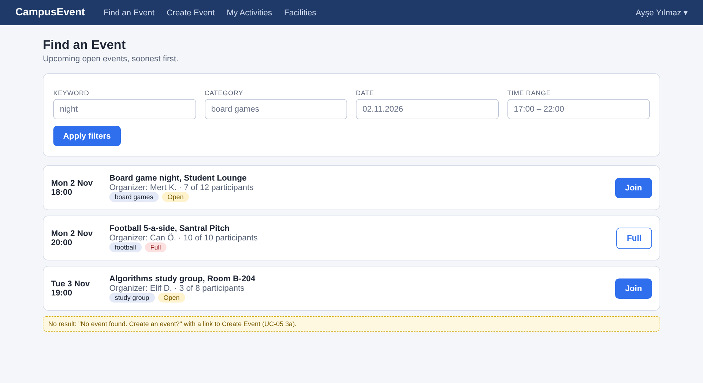

**UC-06, UC-10, UC-11 Event details**

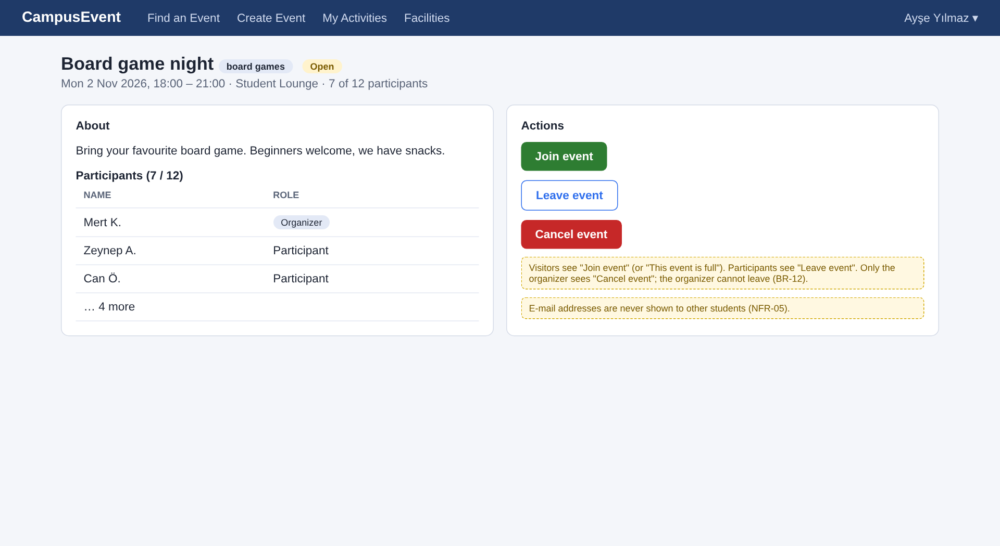

**UC-04, UC-07 Create event**

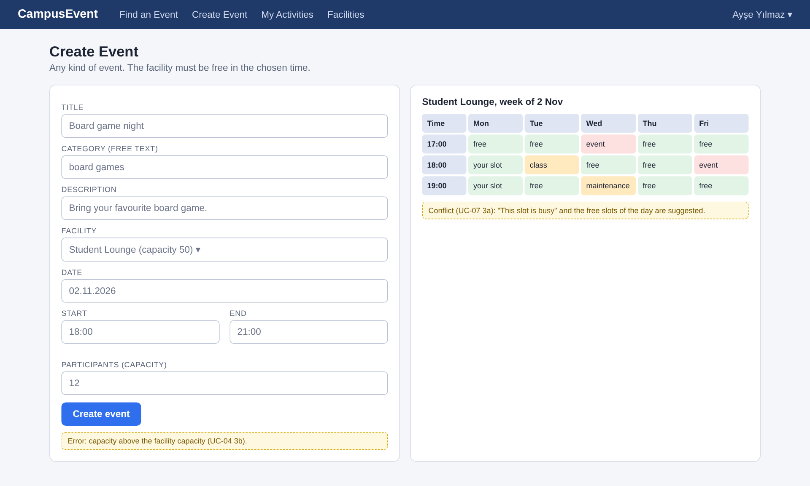

**UC-07, UC-08 Facility management**

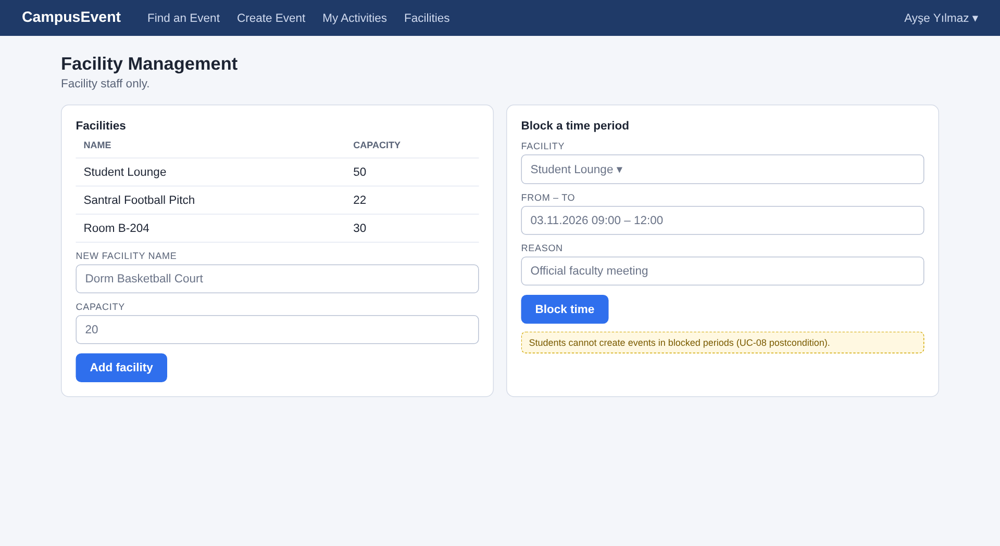

**UC-09 My activities**

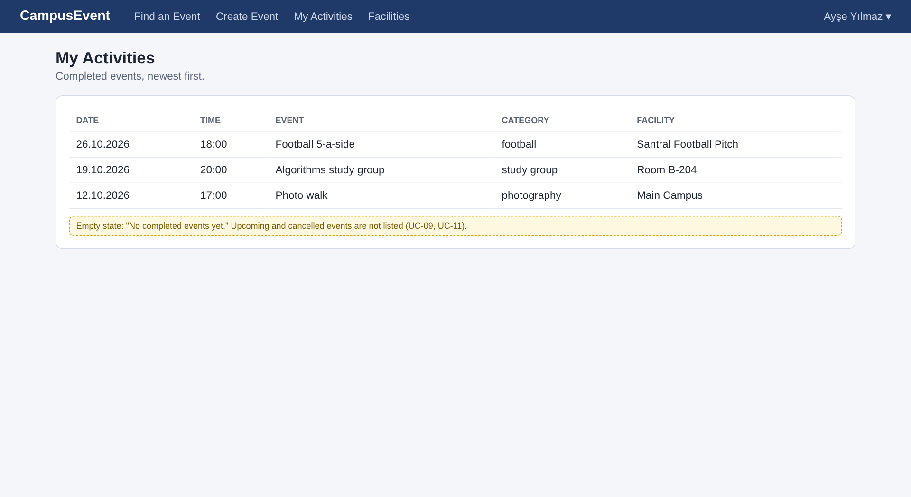

**NFR-01 Find an event on a phone (390 px)**

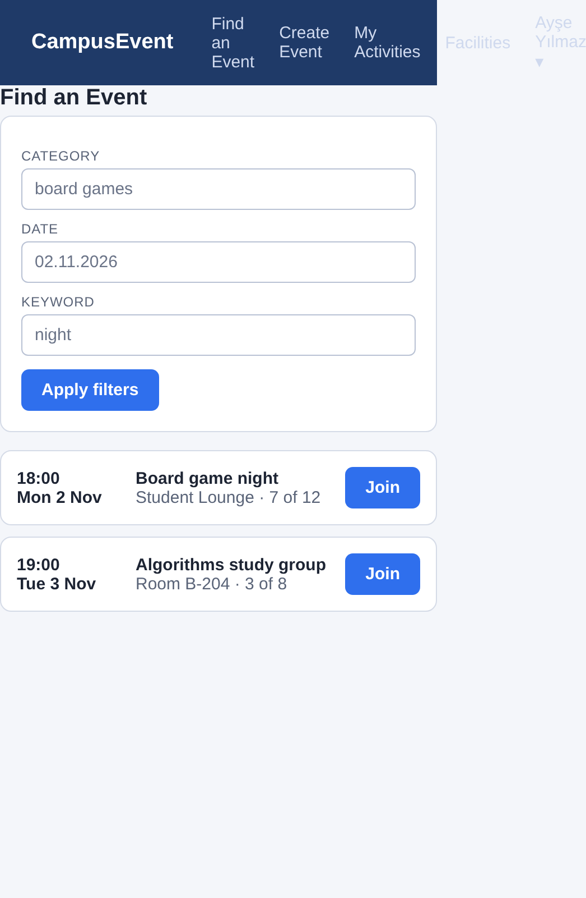

---

## 11. Conclusion

The 11 use cases form a consistent base for design. The analysis added a database-ready data model, business process and data flow diagrams, sequence diagrams and two state diagrams that cover every use case, nine UI mockups with a UI Spec Lite description, 14 business rules, 10 findings and 7 risks. Findings F-01 to F-04 and F-10 were decided by the team because they change use cases and data structures; the rest will be decided during design.
