# CampusEvent – Requirement Analysis Report

**Course:** CMPE 331 – Software Engineering
**Group:** 14
**Team:** Heval Hüseyin Demir, Emre Arda Kum, Emir Gül, Harun Gündaş, Onur Alioğlu
**Repository:** https://github.com/emir-heval-arda-harun/CMPE-331-project
**Version:** 1.1 – 16.10.2026 (deadline 18.10.2026 23:59)

---

## 1. Introduction

### 1.1 Purpose
The [Requirements Specification](requirements_specification.md) states **what** CampusEvent must do in 15 use cases (UC-01 to UC-15). This report **analyzes** those requirements. It builds the conceptual and data models, shows how the system behaves in the important scenarios, collects the business rules, and lists the gaps and risks found in the requirements. The Software Design Report will take these results as its input.

### 1.2 Method
Each use case was read together with the domain classes in [`src/campusevent/models.py`](../src/campusevent/models.py). From them we derived:

1. a conceptual class model, business process diagrams (BPD) and data flow diagrams (DFD) (section 2),
2. a data model with an E-R diagram and data dictionary (section 3),
3. sequence and state diagrams for every use case (section 4),
4. a consolidated list of business rules (section 5),
5. open issues and risks with decisions (sections 6 and 7),
6. a consistency check between requirements and models (section 9) and preliminary UI mockups (section 10).

All diagrams are also stored as separate files (Mermaid source, PNG, SVG) in [`analysis/`](analysis/README.md).

Items marked **(proposed)** are analysis proposals that are not part of a use case yet and will be decided during design. The decisions F-01 to F-05 are already applied to the requirements and models (section 9).

### 1.3 Inputs
| Document | Location |
|---|---|
| Project Charter | [CHARTER.MD](CHARTER.MD) |
| Requirements Specification | [requirements_specification.md](requirements_specification.md) |
| Use cases UC-01 … UC-15 | [requirements/](requirements/README.md) |
| Domain classes | [`src/campusevent/models.py`](../src/campusevent/models.py) |

---

## 2. Conceptual Model

### 2.1 Actors and use-case relations
| Actor | Use cases |
|---|---|
| Student | UC-01 to UC-07 (UC-04, 07, 15 as organizer), UC-11, UC-13, UC-14 |
| Club Representative | UC-02, 08, 09, 10 |
| Facility Staff | UC-02, 12 |
| Gemini Pro (external) | UC-07 |
| E-mail service (external) | UC-01 |

Relations between use cases: UC-04 **includes** UC-11 (facility check). UC-06 **extends** UC-05 (join from the match list). UC-09 needs the tournament from UC-08, and UC-10 needs the bracket from UC-09.

### 2.2 Domain class model
The model below comes from `models.py` and is extended with the relations the use cases imply. Compared with the first version it now also contains `Sport`, `Team`, `Participation` (with the team number of UC-07) and `VerificationCode`, the number of teams of a match (F-02), the stored AI ratings of a profile (F-05) and the optional facility slot of a bracket game (F-04), so that it matches the E-R diagram.

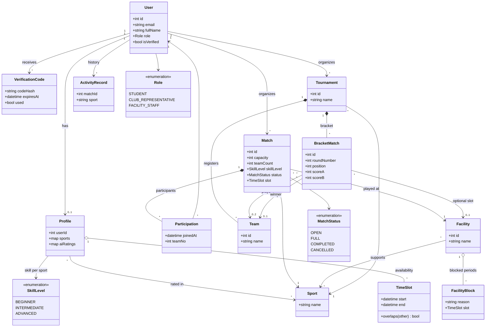

*Diagram files: [`domain_class_model.png`](analysis/data/domain_class_model.png), [source `domain_class_model.mmd`](analysis/data/domain_class_model.mmd)*

### 2.3 Glossary of analysis terms
| Term | Meaning |
|---|---|
| Busy slot | A time slot of a facility that is blocked by staff or already used by a match |
| Free place | `capacity` minus the number of participants of a match |
| Round | A level of the single-elimination bracket; round 1 is the first |
| Bye | A free pass to round 2 for a team without an opponent in round 1 |
| Team rating | The sum of the numeric skill ratings of the players in a team |

### 2.4 Business process models (BPD)
The business process diagrams show who does what in the important processes. Each lane is an actor or the system; diamonds are decisions.

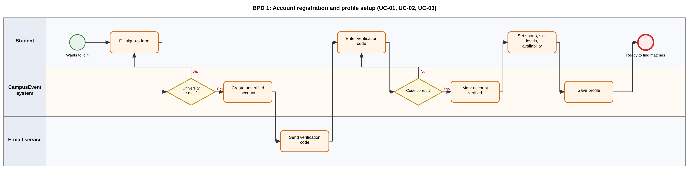
*Files: [png](analysis/process/bpd_account_onboarding.png), [svg](analysis/process/bpd_account_onboarding.svg)*

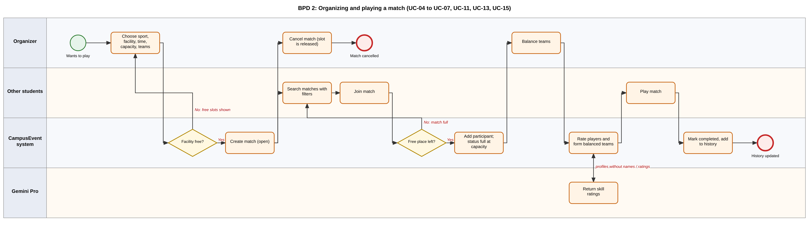
*Files: [png](analysis/process/bpd_match_lifecycle.png), [svg](analysis/process/bpd_match_lifecycle.svg)*

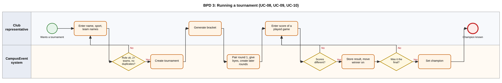
*Files: [png](analysis/process/bpd_tournament.png), [svg](analysis/process/bpd_tournament.svg)*

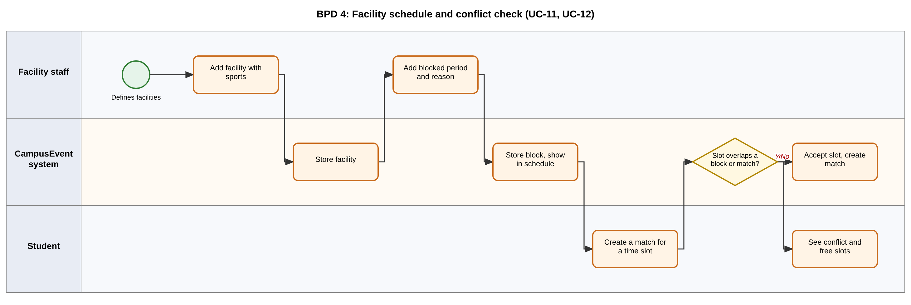
*Files: [png](analysis/process/bpd_facility_management.png), [svg](analysis/process/bpd_facility_management.svg)*

### 2.5 Data flow models (DFD)
The context diagram (level 0) shows CampusEvent as one process with its five external parties. Level 1 splits it into six processes and five data stores. Data flows to the AI service never contain names or e-mail addresses (BR-03).

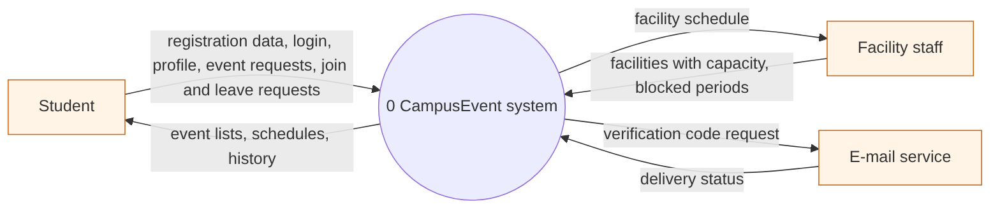
*Files: [png](analysis/process/dfd_level0_context.png), [mermaid source](analysis/process/dfd_level0_context.mmd)*

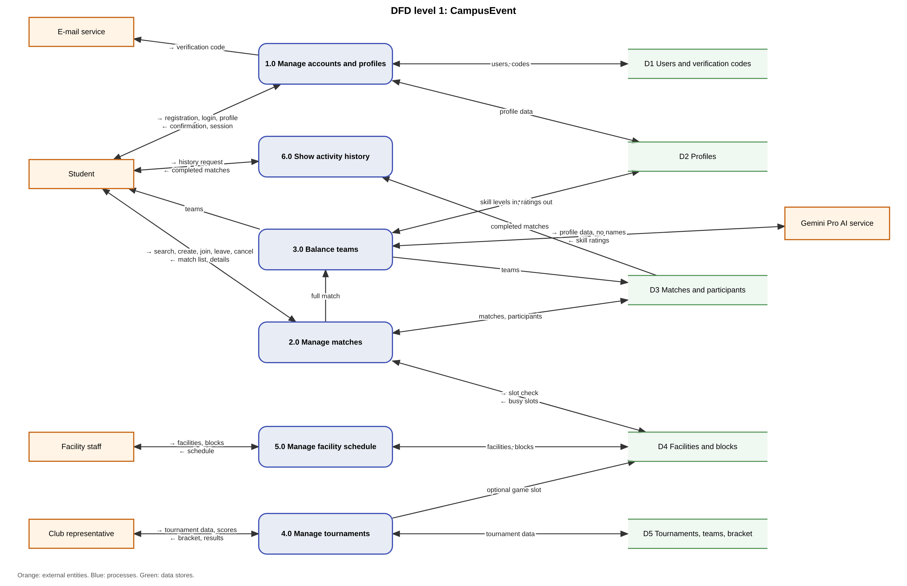
*Files: [png](analysis/process/dfd_level1.png), [svg](analysis/process/dfd_level1.svg)*

| Process | Use cases | Data stores used |
|---|---|---|
| 1.0 Manage accounts and profiles | UC-01, UC-02, UC-03 | D1, D2 |
| 2.0 Manage matches | UC-04, UC-05, UC-06, UC-14, UC-15 | D3, D4 |
| 3.0 Balance teams | UC-07 | D2, D3 |
| 4.0 Manage tournaments | UC-08, UC-09, UC-10 | D5, D4 |
| 5.0 Manage facility schedule | UC-11, UC-12 | D4 |
| 6.0 Show activity history | UC-13 | D3 |

---

## 3. Data Analysis

### 3.1 E-R diagram
The class model keeps sports and teams as plain strings. For a database this is not enough: sports must be shared by profiles, facilities, matches and tournaments, and tournament teams need their own identity so that bracket games can reference them. The E-R diagram therefore adds `SPORT`, `TEAM` and link tables.

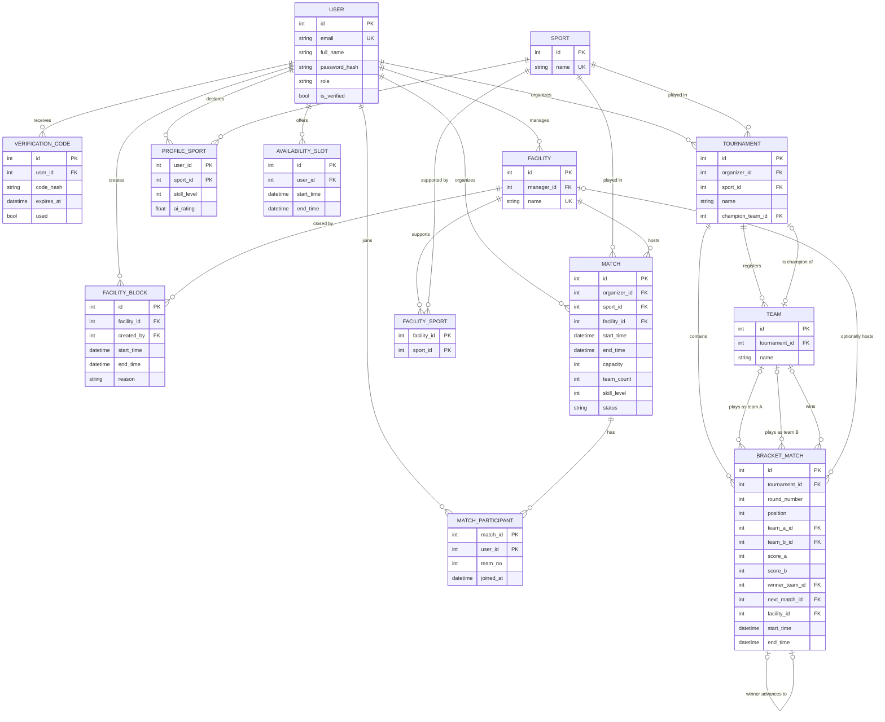

*Diagram files: [`er_diagram.png`](analysis/data/er_diagram.png), [source `er_diagram.mmd`](analysis/data/er_diagram.mmd)*

### 3.2 Data dictionary (main constraints)
| Entity | Constraint | Source |
|---|---|---|
| USER | `email` unique; domain must be `bilgiedu.net` or `bilgi.edu.tr`; `password_hash` is never plain text | UC-01, BR-01, BR-02 |
| USER | `role` is one of student, club_representative, facility_staff | `Role` enum |
| PROFILE_SPORT | One row per user and sport; `skill_level` is 1 to 3; a profile needs at least one row | UC-03 |
| PROFILE_SPORT | `ai_rating` holds the last AI rating of this sport (empty until UC-07 ran) | UC-07, F-05 |
| FACILITY | `manager_id` is a user with the facility staff role | UC-12, F-03 |
| FACILITY_BLOCK | `created_by` is the facility staff member who blocked the time | UC-12 |
| AVAILABILITY_SLOT | `end_time` is after `start_time` | UC-03 alt. 6b |
| FACILITY_SPORT | A facility supports at least one sport | UC-12 |
| FACILITY_BLOCK | `end_time` is after `start_time`; blocks of one facility must not overlap each other | UC-11, 12 |
| MATCH | `capacity` is at least 2; the facility must support the sport; the time slot must not overlap any block or other match of the same facility | UC-04, UC-11 |
| MATCH | `team_count` is at least 2 (default 2) and `capacity` is at least `team_count` × 2 | UC-04, UC-07, F-02 |
| MATCH | `status` is one of open, full, completed, cancelled | `MatchStatus` enum |
| MATCH_PARTICIPANT | A user can join a match only once (composite key); number of rows is at most `capacity` | UC-06 |
| MATCH_PARTICIPANT | `team_no` is set by UC-07; team sizes differ by at most 1 | UC-07 |
| TOURNAMENT | At least 2 teams before a bracket can be generated | UC-08, UC-09 |
| TEAM | Team name unique inside a tournament | UC-08 alt. 3a |
| BRACKET_MATCH | `facility_id`, `start_time` and `end_time` are optional; if set, the slot counts as busy for UC-11 | UC-11, F-04 |
| BRACKET_MATCH | `round_number` and `position` unique per tournament; `score_a` and `score_b` must differ; `winner_team_id` is one of the two teams | UC-09, UC-10 |

### 3.3 Design notes for the database
- **Integrity of facility use.** The rule "no two activities share a facility at the same time" cannot be guaranteed by application code alone, because two students can book at the same moment. The database should enforce it (for example with a transaction and a row lock on the facility, or an exclusion constraint on the time range if the chosen database supports it).
- **Capacity.** Joining a match must count participants and insert the new row in one transaction. Otherwise two simultaneous joins can exceed `capacity`.
- **Bracket tree.** `next_match_id` links a game to the game where its winner continues. Advancing a winner (UC-10 step 3) is then one update, and the final game has `next_match_id` empty.
- **Normal form.** All tables are in 3NF: link tables hold only key attributes and facts about the pair, and sports are stored once.
- **Time zone.** All times are stored in UTC and shown in Europe/Istanbul **(proposed)**.

---

## 4. Behavior Analysis

### 4.1 Sequence: register and verify (UC-01)
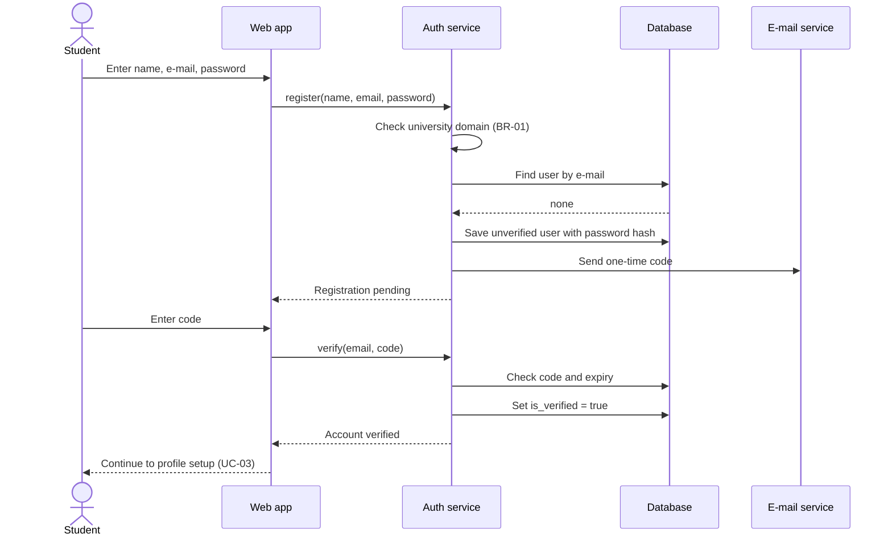

*Diagram files: [`sequence_uc01_register_verify.png`](analysis/behavior/sequence_uc01_register_verify.png), [source `sequence_uc01_register_verify.mmd`](analysis/behavior/sequence_uc01_register_verify.mmd)*

### 4.2 Sequence: create a match with conflict check (UC-04 and UC-11)
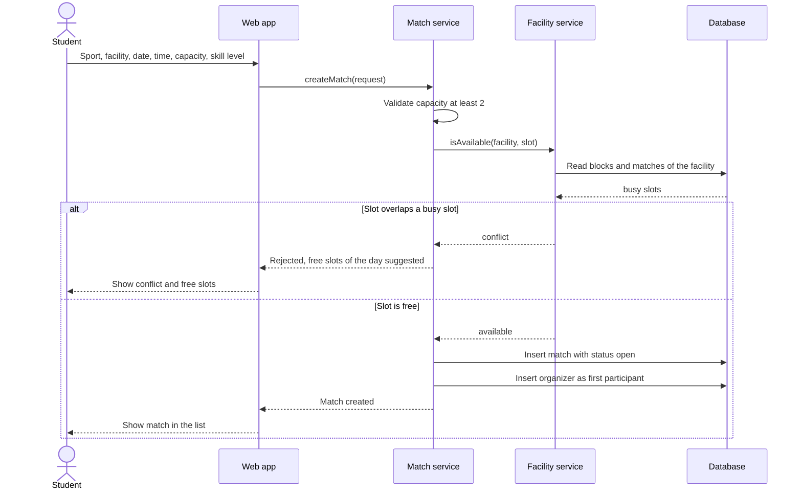

*Diagram files: [`sequence_uc04_uc11_create_match.png`](analysis/behavior/sequence_uc04_uc11_create_match.png), [source `sequence_uc04_uc11_create_match.mmd`](analysis/behavior/sequence_uc04_uc11_create_match.mmd)*
Analysis note: the availability check and the insert must run in **one transaction**; otherwise two students can both pass the check for the same slot.

### 4.3 Sequence: AI team balancing with fallback (UC-07)
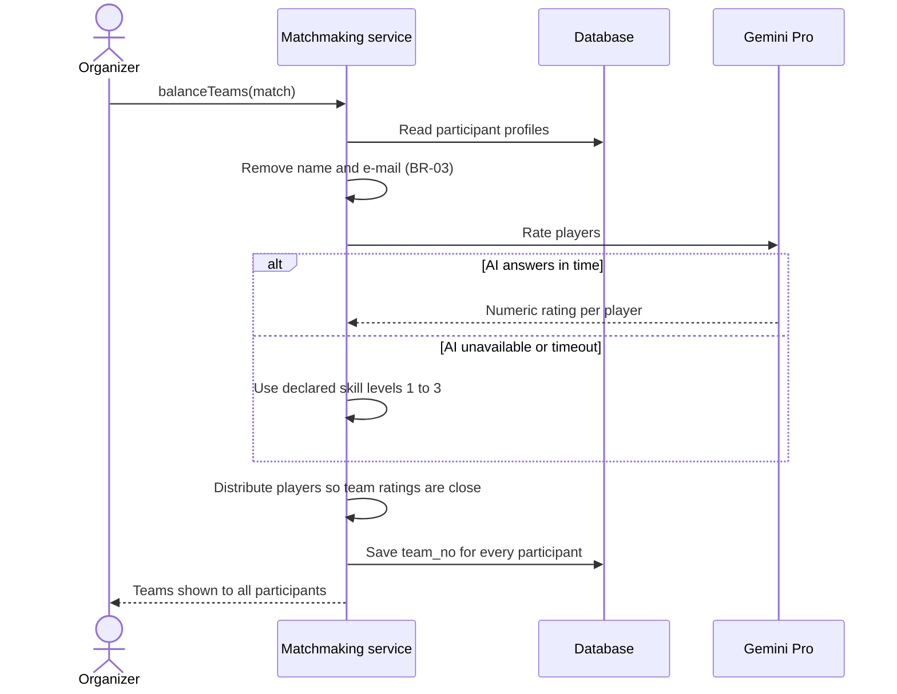

*Diagram files: [`sequence_uc07_team_balancing.png`](analysis/behavior/sequence_uc07_team_balancing.png), [source `sequence_uc07_team_balancing.mmd`](analysis/behavior/sequence_uc07_team_balancing.mmd)*
Analysis note: NFR-03 allows 10 seconds including the AI call. The timeout for the AI call must therefore be shorter (about 5 seconds is proposed) so that the fallback still fits in the limit.

### 4.4 Sequence: record a score and advance the winner (UC-10)
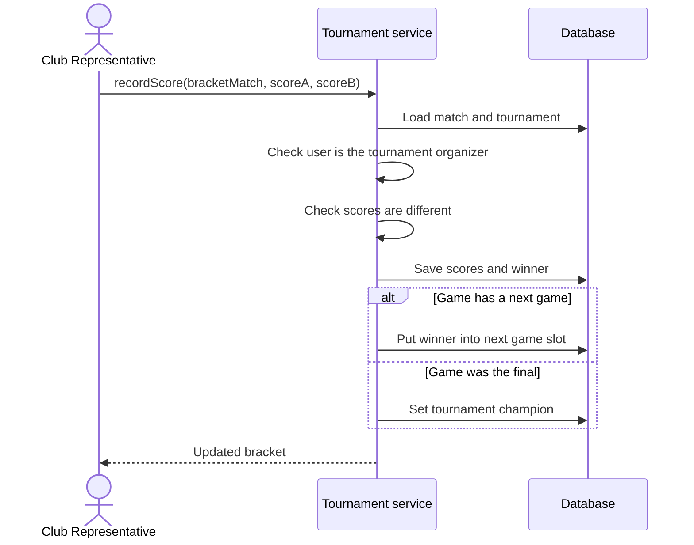

*Diagram files: [`sequence_uc10_record_score.png`](analysis/behavior/sequence_uc10_record_score.png), [source `sequence_uc10_record_score.mmd`](analysis/behavior/sequence_uc10_record_score.mmd)*

### 4.5 State diagrams

**Match** (UC-04, UC-06, UC-13). Leaving (UC-14) and cancelling (UC-15) are use cases since F-01 was applied; the transition to Completed happens automatically when the end time has passed.

*Diagram files: [`state_match.png`](analysis/behavior/state_match.png), [source `state_match.mmd`](analysis/behavior/state_match.mmd)*

**User account** (UC-01, UC-02).
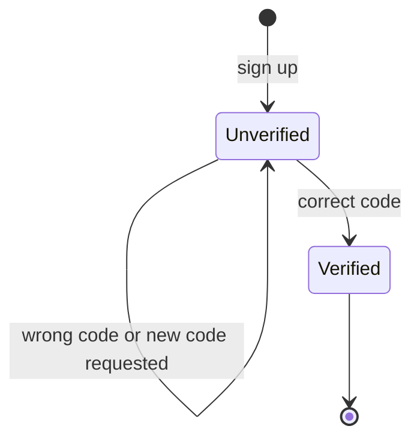

*Diagram files: [`state_user_account.png`](analysis/behavior/state_user_account.png), [source `state_user_account.mmd`](analysis/behavior/state_user_account.mmd)*
Only verified accounts can log in (UC-02 step 3).

**Tournament** (UC-08, UC-09, UC-10).
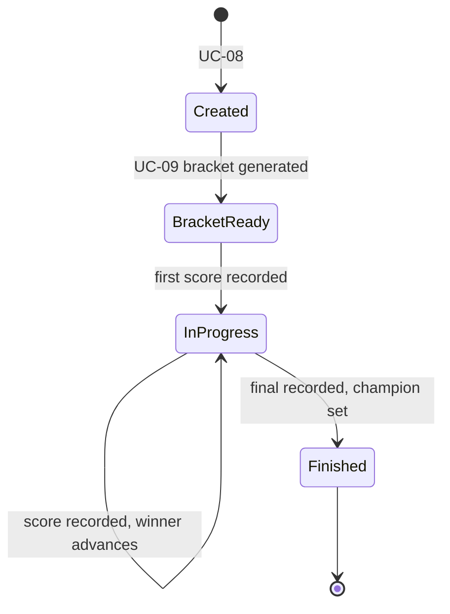

*Diagram files: [`state_tournament.png`](analysis/behavior/state_tournament.png), [source `state_tournament.mmd`](analysis/behavior/state_tournament.mmd)*

### 4.6 Sequence diagrams of the remaining use cases

**UC-02 Log in**

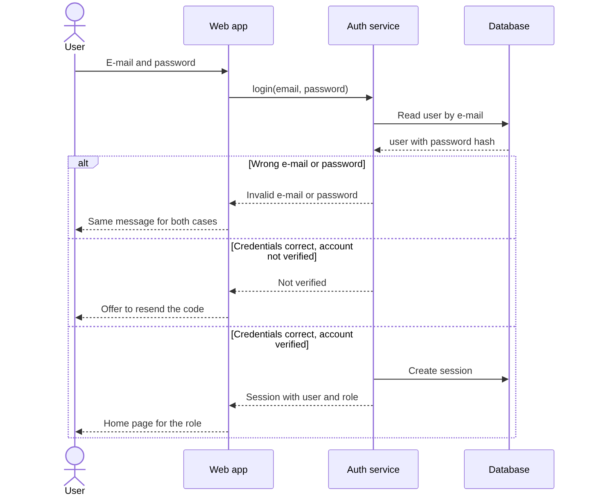
*Files: [png](analysis/behavior/sequence_uc02_login.png), [source](analysis/behavior/sequence_uc02_login.mmd)*

**UC-03 Manage profile**

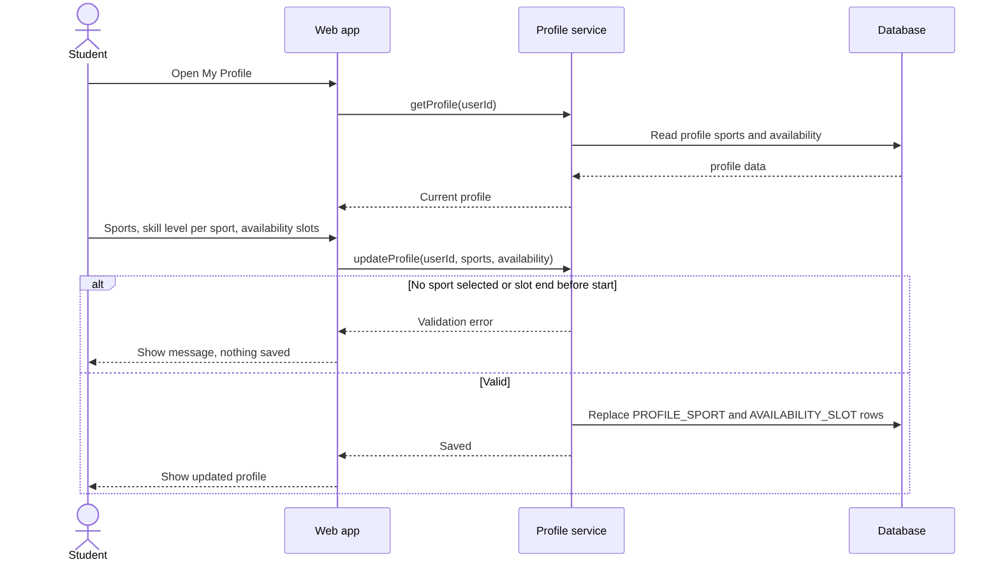
*Files: [png](analysis/behavior/sequence_uc03_manage_profile.png), [source](analysis/behavior/sequence_uc03_manage_profile.mmd)*

**UC-05, UC-06 Browse, filter and join**

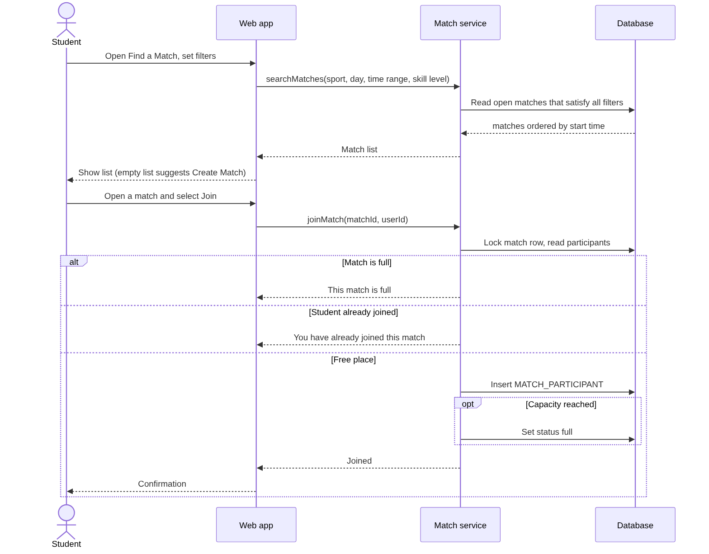
*Files: [png](analysis/behavior/sequence_uc05_uc06_browse_and_join.png), [source](analysis/behavior/sequence_uc05_uc06_browse_and_join.mmd)*

**UC-08, UC-09 Create tournament and generate bracket**

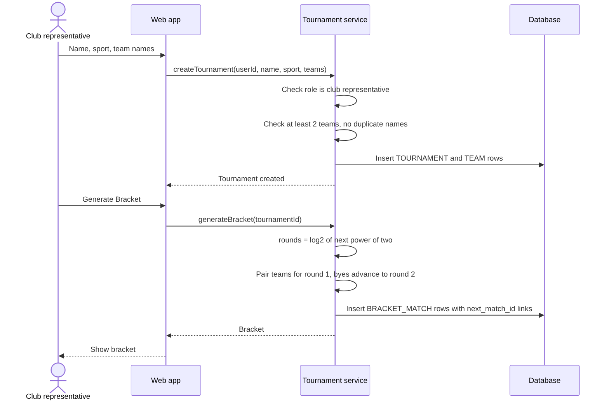
*Files: [png](analysis/behavior/sequence_uc08_uc09_tournament_and_bracket.png), [source](analysis/behavior/sequence_uc08_uc09_tournament_and_bracket.mmd)*

**UC-12 Manage facility schedule**

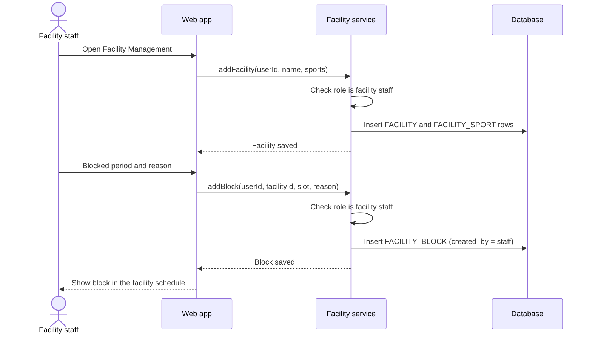
*Files: [png](analysis/behavior/sequence_uc12_manage_facility_schedule.png), [source](analysis/behavior/sequence_uc12_manage_facility_schedule.mmd)*

**UC-13 Track activity history**

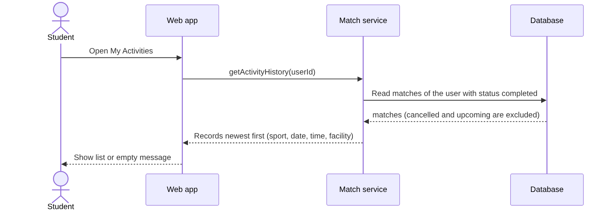
*Files: [png](analysis/behavior/sequence_uc13_activity_history.png), [source](analysis/behavior/sequence_uc13_activity_history.mmd)*

**UC-14, UC-15 Leave and cancel a match**

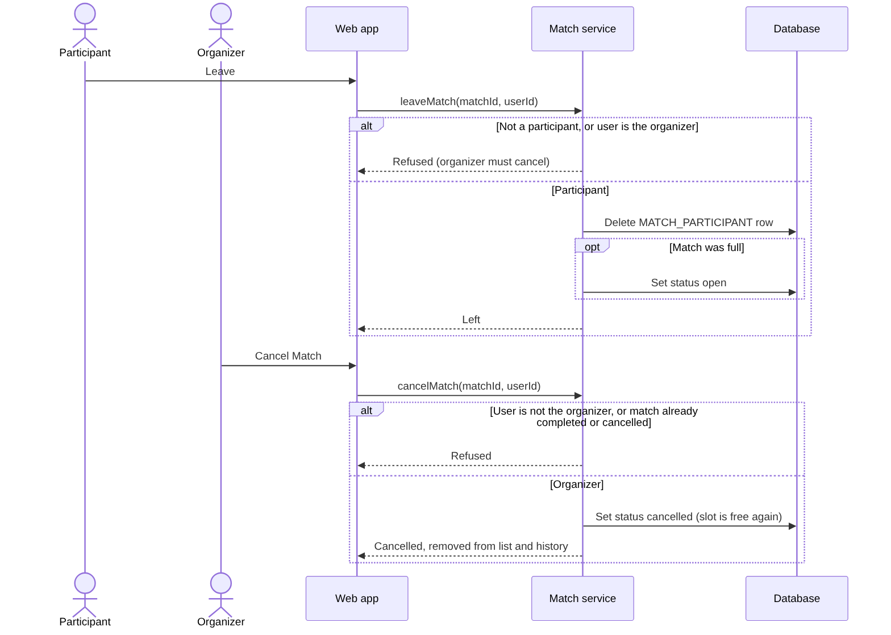
*Files: [png](analysis/behavior/sequence_uc14_uc15_leave_and_cancel.png), [source](analysis/behavior/sequence_uc14_uc15_leave_and_cancel.mmd)*

### 4.7 Behavior model coverage
Every use case has at least one behavioral model.

| Use case | Model |
|---|---|
| UC-01 | Sequence 4.1, account state 4.5, BPD 1 |
| UC-02 | Sequence 4.6, account state 4.5, BPD 1 |
| UC-03 | Sequence 4.6, BPD 1 |
| UC-04 | Sequence 4.2, match state 4.5, BPD 2 |
| UC-05, UC-06 | Sequence 4.6, match state 4.5, BPD 2 |
| UC-07 | Sequence 4.3, BPD 2 |
| UC-08, UC-09 | Sequence 4.6, tournament state 4.5, BPD 3 |
| UC-10 | Sequence 4.4, tournament state 4.5, BPD 3 |
| UC-11 | Sequence 4.2, BPD 4 |
| UC-12 | Sequence 4.6, BPD 4 |
| UC-13 | Sequence 4.6, match state 4.5 |
| UC-14, UC-15 | Sequence 4.6, match state 4.5, BPD 2 |

---

## 5. Business Rules

| ID | Rule | Source |
|---|---|---|
| BR-01 | Only university e-mail domains are accepted | UC-01 |
| BR-02 | Passwords are never stored in plain text | UC-01 |
| BR-03 | Only data needed for rating is sent to the AI service; no name or e-mail | UC-07 |
| BR-04 | Only verified users can log in **(derived)** | UC-02 |
| BR-05 | A match needs capacity of at least 2 **(derived)** | UC-04 |
| BR-06 | No two matches or blocks may use the same facility at the same time **(derived)** | UC-11 |
| BR-07 | A user joins a match at most once, and never above capacity **(derived)** | UC-06 |
| BR-08 | Only club representatives create tournaments and enter scores **(derived)** | UC-08, 10 |
| BR-09 | Only facility staff manage facilities and blocks **(derived)** | UC-12 |
| BR-10 | An elimination game needs a winner: equal scores are rejected **(derived)** | UC-10 |
| BR-11 | Every team appears exactly once in round 1, as a player or with a bye **(derived)** | UC-09 |
| BR-12 | Every participant belongs to exactly one team after balancing; sizes differ by at most 1 **(derived)** | UC-07 |
| BR-13 | The history shows only completed matches, newest first **(derived)** | UC-13 |
| BR-14 | An organizer cannot leave their own match; the match has to be cancelled | UC-14 |
| BR-15 | A cancelled match never appears in the activity history and does not occupy its facility slot | UC-15, UC-11, UC-13 |

---

## 6. Analysis Findings: Gaps and Proposed Decisions

Reading the use cases against each other showed the following gaps. Each has a decision. The team accepted the proposed decisions for F-01 to F-05 on 12.10.2026; F-06 to F-10 will be decided during design.

| # | Finding | Why it matters | Decision |
|---|---|---|---|
| F-01 | `MatchStatus` has Completed and Cancelled, but no use case completes, cancels or leaves a match | UC-13 lists completed matches, so something must set that status | Add small use cases: leave match, cancel match. Mark a match Completed automatically when its end time has passed **Applied** (section 9) |
| F-02 | UC-07 needs "teams × 2" players, but no use case defines the number of teams of a match | The balancing algorithm needs the team count | Add `team_count` (default 2) to the match in UC-04 **Applied** (section 9) |
| F-03 | Nothing says how a user becomes a Club Representative or Facility Staff | Roles protect UC-08 to UC-12, so they must come from somewhere | Roles are assigned by an administrator or loaded as seed data for the demo; document this as an assumption **Applied** (section 9) |
| F-04 | Tournament teams are plain names with no users, and bracket games have no facility or time | The charter lists facility coordination, but tournament games ignore it | For the MVP keep teams as names, and add an optional facility slot to a bracket game so UC-11 also protects tournament games **Applied** (section 9) |
| F-05 | The AI returns a rating, but no place stores it | Ratings would be recomputed on every balancing and cannot be checked later | Store the last rating per user and sport in `PROFILE_SPORT` (optional column) **Applied** (section 9) |
| F-06 | Password reset is missing | A forgotten password locks the account | Add as a Low priority use case, or declare it out of scope |
| F-07 | Charter lists Python and Java as backend, the specification and code use Python only | Two languages would split the team's effort | Confirm Python as the single backend language and update the charter |
| F-08 | The charter's out-of-scope list says communication is "text-based chat", the specification says in-app chat is out of scope | The two documents contradict each other | Treat chat as out of scope and correct the charter wording |
| F-09 | UC-03 shows the profile on a "public page" | The page can expose availability and skill of students | Show only name, sports and skill level publicly; keep availability private |
| F-10 | UC-13 only shows completed matches | Students cannot see their upcoming matches in one place (UC-06 postcondition promises this) | Extend UC-13 with an "Upcoming" tab |

---

## 7. Risk Analysis

| ID | Risk | Likelihood | Impact | Mitigation |
|---|---|---|---|---|
| R-01 | Gemini Pro is slow, unavailable or its quota runs out | Medium | Medium | Fallback to declared skill levels (UC-07 alt. 2a), a short timeout, caching of ratings (F-05) |
| R-02 | Double booking or overfull matches caused by simultaneous requests | Medium | High | Transactions and database constraints (section 3.3) and tests with parallel requests |
| R-03 | Verification e-mails land in spam or are delayed | Medium | Medium | Resend option (UC-01 alt. 5a), short test with both university domains, clear message to the user |
| R-04 | The critical path (71 days, see the [PERT chart](plan/README.md#pert-chart)) has no slack: a delay in Accounts & Profiles, the Web UI or Deployment delays the codebase deadline of 30.11.2026 | Medium | High | Build High priority use cases first (UC-01 to 06, 11), then Medium ones; Low priority UC-13 last |
| R-05 | Unresolved gaps (section 6) change the design late | Medium | Medium | F-01 to F-05 are decided (section 6); F-06 to F-10 are decided before the Software Design Report on 15.11.2026 |
| R-06 | Personal data of students is exposed or processed unlawfully (KVKK) | Low | High | BR-03, hashed passwords, HTTPS, public profile limited to non-sensitive fields (F-09) |

---

## 8. Traceability

| Use case | Analysis artifacts |
|---|---|
| UC-01 | Sequence 4.1, account state 4.5, entities USER and VERIFICATION_CODE, BR-01, BR-02, R-03 |
| UC-02 | Account state 4.5, BR-04 |
| UC-03 | Entities PROFILE_SPORT and AVAILABILITY_SLOT, F-09 |
| UC-04 | Sequence 4.2, entity MATCH, BR-05, BR-06, F-02 |
| UC-05 | Entity MATCH (filter columns: sport, start time, skill level) |
| UC-06 | Match state 4.5, entity MATCH_PARTICIPANT, BR-07, R-02 |
| UC-07 | Sequence 4.3, `team_no`, BR-03, BR-12, F-02, F-05, R-01 |
| UC-08 | Tournament state 4.5, entities TOURNAMENT and TEAM, BR-08, F-04 |
| UC-09 | Entity BRACKET_MATCH, tournament state 4.5, BR-11 |
| UC-10 | Sequence 4.4, entity BRACKET_MATCH (`next_match_id`), BR-10 |
| UC-11 | Sequence 4.2, entities FACILITY_BLOCK and MATCH, BR-06, R-02 |
| UC-12 | Entities FACILITY, FACILITY_SPORT and FACILITY_BLOCK, BR-09, F-03 |
| UC-13 | Match state 4.5, BR-13, BR-15, F-01, F-10 |
| UC-14 | Sequence 4.6, match state 4.5, BR-14, F-01 |
| UC-15 | Sequence 4.6, match state 4.5, BR-15, F-01 |

---

## 9. Consistency Check between Requirements and Models
The requirements (use cases, tests, specification) and the analysis models were compared one by one. The differences found and what was changed:

| # | Difference found | Change |
|---|---|---|
| 1 | The match state diagram had transitions (leave, cancel) without a use case (F-01) | New use cases [UC-14](requirements/UC-14_leave_match.md) and [UC-15](requirements/UC-15_cancel_match.md), tests, use case diagram, specification and traceability updated |
| 2 | UC-07 needs "teams × 2" players, but UC-04 had no number of teams (F-02) | UC-04 asks for the number of teams; `team_count` added to `Match`, MATCH and the tests |
| 3 | The AI rating of UC-07 was not stored anywhere (F-05) | UC-07 step 3 stores it; `ai_ratings` in `Profile`, `ai_rating` in PROFILE_SPORT |
| 4 | The domain model used plain strings for sports and teams while the E-R diagram had SPORT and TEAM | Domain model now has `Sport`, `Team`, `Participation` and `VerificationCode` |
| 5 | E-R: no relation for the champion, the three team roles of a bracket game, the next game and the optional facility slot (F-04) | Added `TEAM` relations (team A, team B, winner, champion), `BRACKET_MATCH` self relation and `FACILITY` relation; columns `facility_id`, `start_time`, `end_time` |
| 6 | E-R: nobody was linked to facilities and blocks, although UC-12 is done by facility staff (F-03) | Relations `USER manages FACILITY` and `USER creates FACILITY_BLOCK` (`manager_id`, `created_by`) |
| 7 | UC-11 only knew matches and blocks as busy slots | UC-11 also counts tournament games with a slot and ignores cancelled matches |
| 8 | UC-13 did not say what happens to cancelled matches | UC-13 and BR-15: cancelled matches are never shown |
| 9 | Roles of club representatives and facility staff had no source (F-03) | Assumption A-04 in the Requirements Specification and in UC-12 |
| 10 | Only 4 of 13 use cases had a behavioral model | All 15 use cases are covered (section 4.7) |

Test counts after the change: 54 tests (43 use case tests and 11 non-functional tests), all failing by design.

## 10. Preliminary UI Mockups
The frontend design starts with low-fidelity mockups of the main screens. They are plain HTML pages ([`analysis/ui/`](analysis/ui/README.md)); the final design will be refined with the team. Yellow notes show error cases and rules from the use cases. NFR-01 requires a responsive layout, so a 390 px mobile view is included.

**UC-01 Sign up and verify**

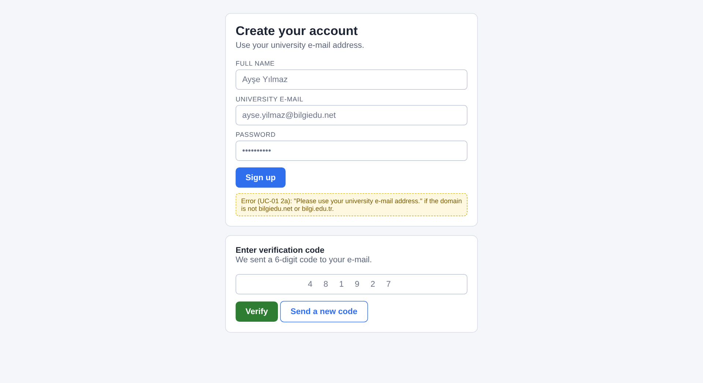

**UC-02 Log in**

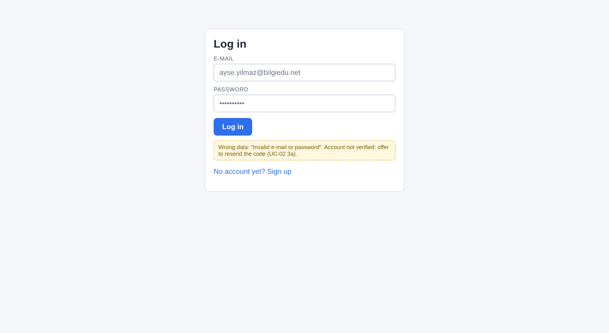

**UC-03 My profile**

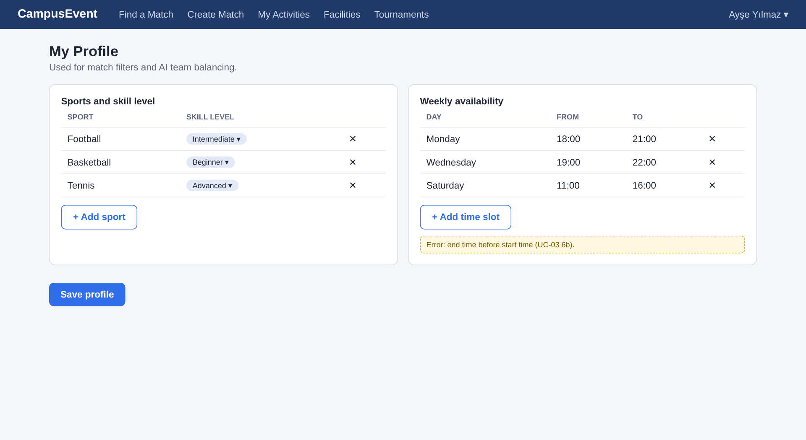

**UC-05, UC-06 Find a match**

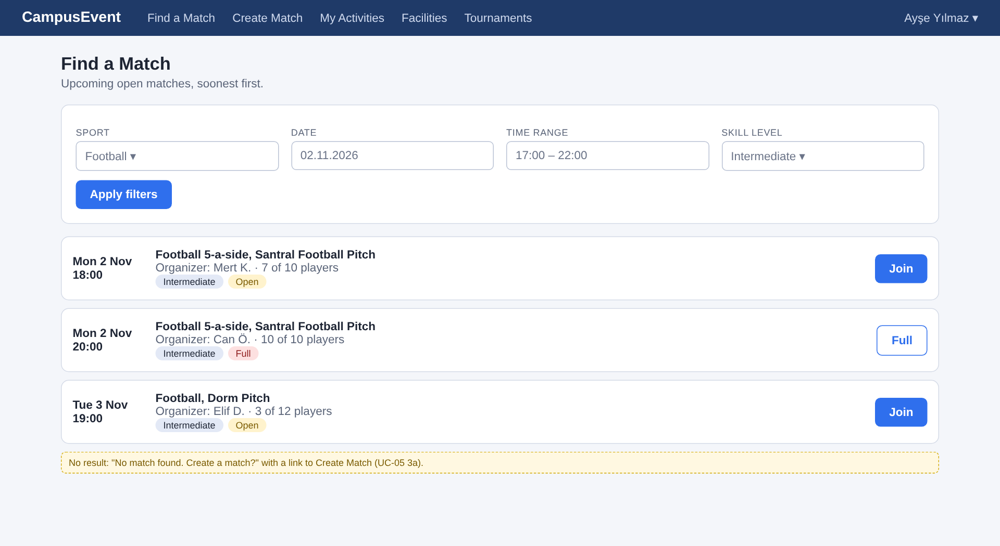

**UC-06, UC-07, UC-14, UC-15 Match details**

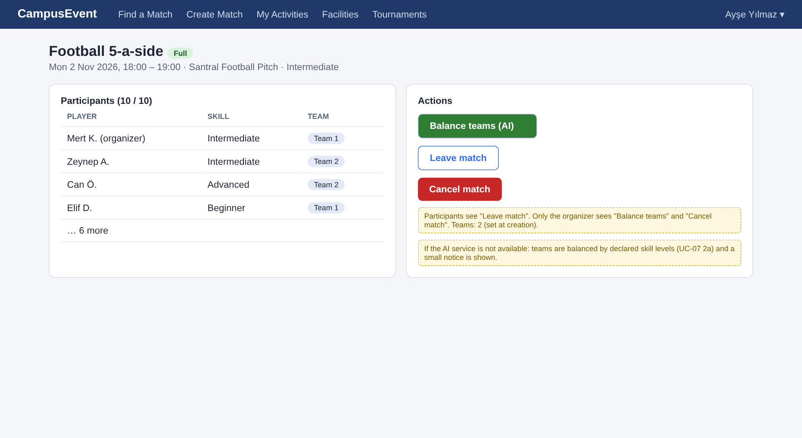

**UC-04, UC-11 Create match**

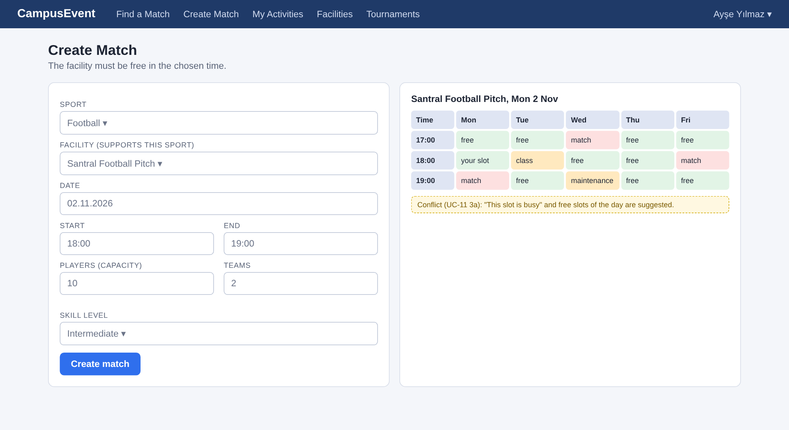

**UC-08, UC-09, UC-10 Tournament bracket**

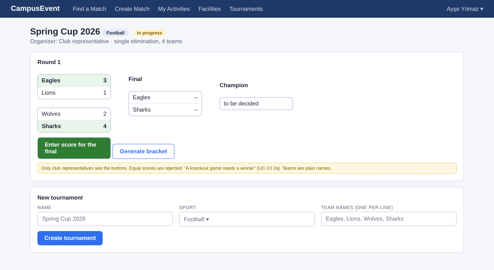

**UC-11, UC-12 Facility management**

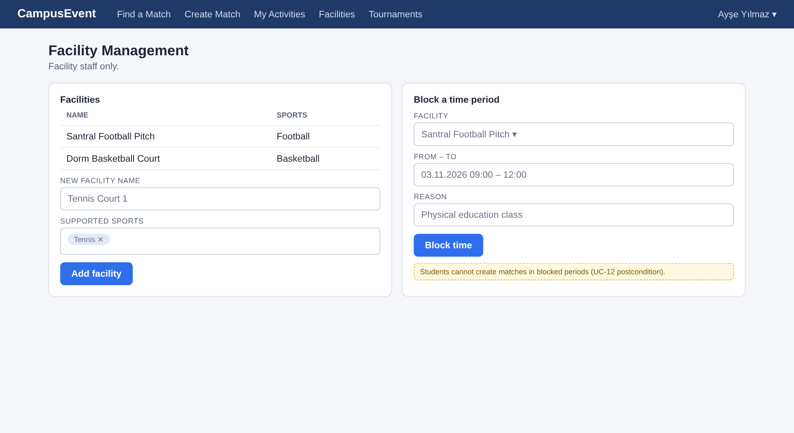

**UC-13 My activities**

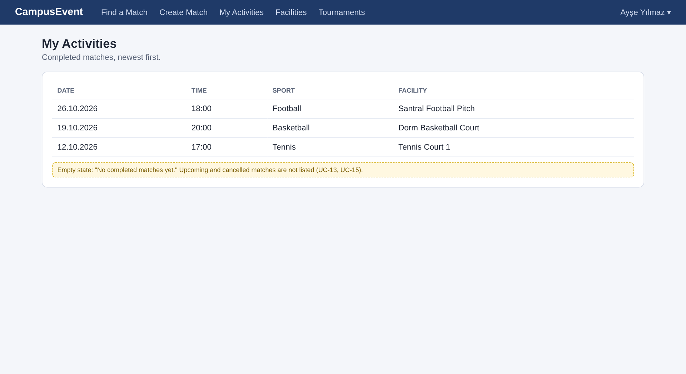

**NFR-01 Find a match on a phone (390 px)**

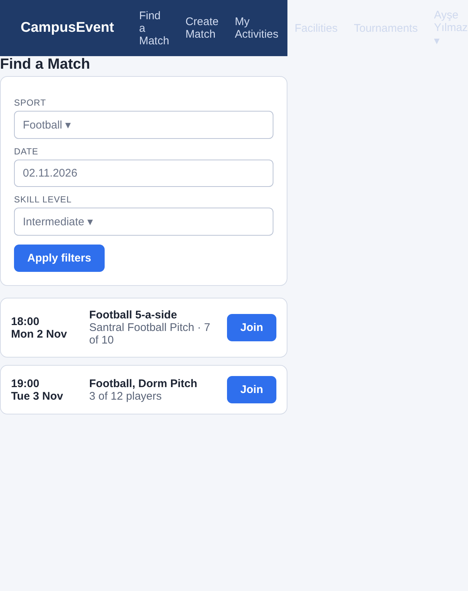

---

## 11. Conclusion

The 15 use cases form a consistent base for design. The analysis added a database-ready data model, business process and data flow diagrams, eleven sequence diagrams and three state diagrams that cover every use case, ten UI mockups, 15 business rules, 10 findings and 6 risks. Findings F-01 to F-05 were decided by the team because they change use cases and data structures; the rest will be decided during design.
