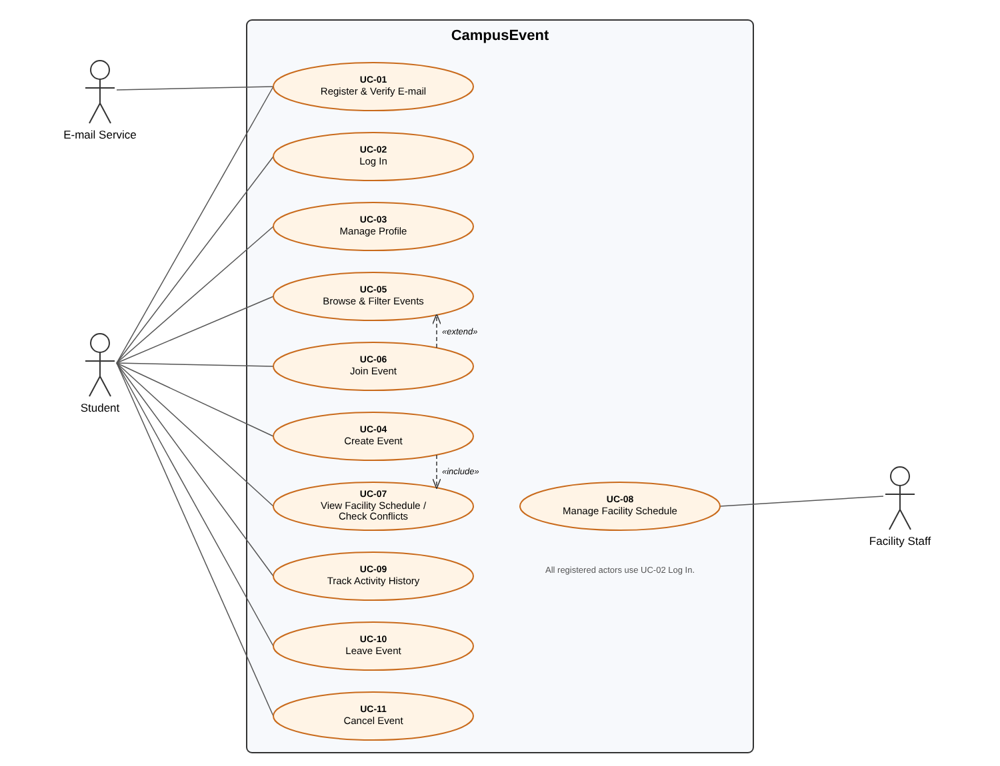

# CampusEvent – Use Cases

Requirements are written in **use case format**. Each use case has its own file and a matching test file under [`tests/`](../../tests).

| ID | Use Case | Primary Actor | Priority | Test |
|---|---|---|---|---|
| [UC-01](UC-01_register_and_verify.md) | Register with university e-mail and verify account | Student | High | [test](../../tests/test_uc01_register_and_verify.py) |
| [UC-02](UC-02_login.md) | Log in | All registered users | High | [test](../../tests/test_uc02_login.py) |
| [UC-03](UC-03_manage_profile.md) | Manage profile (interests, availability) | Student | High | [test](../../tests/test_uc03_manage_profile.py) |
| [UC-04](UC-04_create_event.md) | Create event | Student | High | [test](../../tests/test_uc04_create_event.py) |
| [UC-05](UC-05_browse_and_filter_events.md) | Browse and filter events | Student | High | [test](../../tests/test_uc05_browse_and_filter_events.py) |
| [UC-06](UC-06_join_event.md) | Join event | Student | High | [test](../../tests/test_uc06_join_event.py) |
| [UC-07](UC-07_facility_availability.md) | View facility schedule and check conflicts | Student | High | [test](../../tests/test_uc07_facility_availability.py) |
| [UC-08](UC-08_manage_facility_schedule.md) | Manage facility schedule | Facility Staff | Medium | [test](../../tests/test_uc08_manage_facility_schedule.py) |
| [UC-09](UC-09_activity_history.md) | Track activity history | Student | Low | [test](../../tests/test_uc09_activity_history.py) |
| [UC-10](UC-10_leave_event.md) | Leave event | Student | Medium | [test](../../tests/test_uc10_leave_event.py) |
| [UC-11](UC-11_cancel_event.md) | Cancel event | Student (organizer) | Medium | [test](../../tests/test_uc11_cancel_event.py) |

The diagram is generated from [`diagrams/make_use_case_diagram.py`](diagrams/make_use_case_diagram.py).

## Non-functional requirement tests
The non-functional requirements (NFR-01 ... NFR-07) are defined in the [Requirements Specification](../requirements_specification.md#5-non-functional-requirements). The ones that can be checked by code are tested in [`tests/test_nfr.py`](../../tests/test_nfr.py). Like the use case tests, they fail until the feature is implemented.

| NFR | Category | Check | Test / how it is verified |
|---|---|---|---|
| NFR-01 | Usability | Responsive from 360 px to desktop width | Manual: open each page in the browser developer tools at 360 px and desktop width |
| NFR-02 | Performance | Event search < 2 s for 1,000 open events | `test_nfr02_search_is_fast_with_1000_open_events` |
| NFR-03 | Security | Passwords stored only as salted hashes | `test_nfr03_password_is_never_stored_in_plain_text`, `test_nfr03_same_password_gives_different_stored_values` |
| NFR-04 | Security | Role-based access | `test_nfr04_*` (3 tests) |
| NFR-05 | Privacy | Only the data needed for an event is shown to other students | Manual: review of the event and participant pages |
| NFR-06 | Maintainability | One command runs all tests | Verified by running `python -m pytest` |
| NFR-07 | Portability | Works in Chrome, Firefox, Safari and Edge | Manual: open the main pages in each browser |

HTTPS (NFR-03) is a deployment setting and is checked during the CI/CD & Deploy task.
