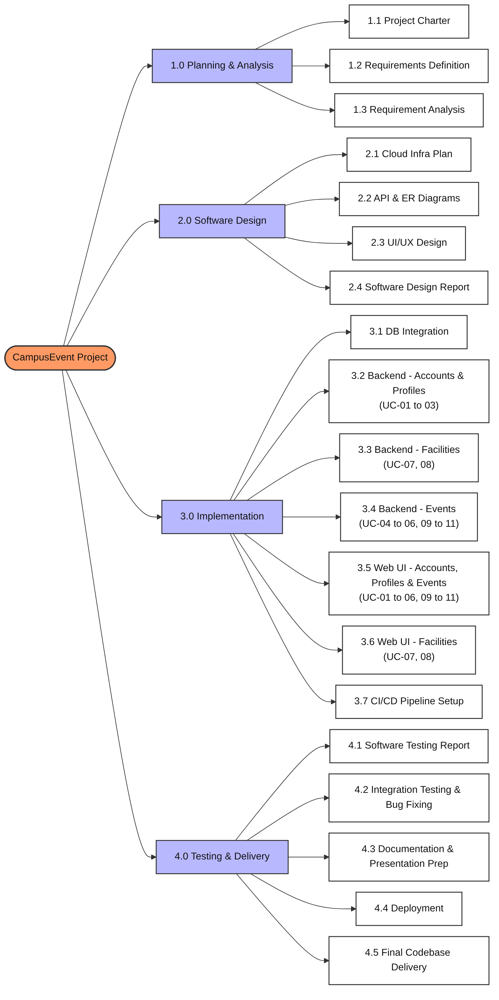
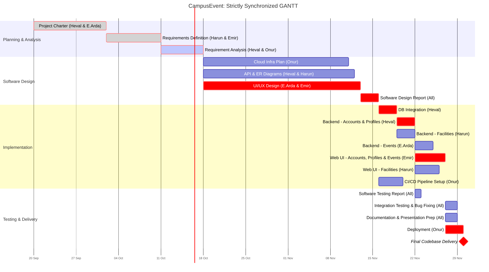
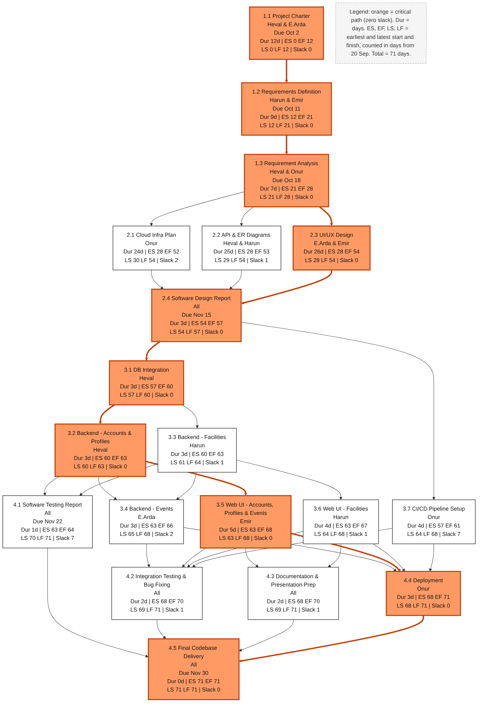

# CampusEvent – Requirements Specification Report

**Course:** CMPE 331 – Software Engineering
**Group:** 14
**Team:** Heval Hüseyin Demir, Emre Arda Kum, Emir Gül, Harun Gündaş, Onur Alioğlu
**Repository:** https://github.com/emir-heval-arda-harun/CMPE-331-project
**Date:** 07.10.2026 (updated 16.10.2026: scope generalized to all event types)

---

## 1. Introduction

### 1.1 Purpose
This document defines the requirements of **CampusEvent**, a campus event platform for university students, where students organize and join events of any kind (sports, study groups, game nights, club meetings and more). It is the reference for the design, implementation and testing phases of the project.

### 1.2 Scope
CampusEvent lets students organize, find and join events at campus facilities, and prevents facility booking conflicts. An event has a free-text category, so any kind of event is possible.

**In scope:** user authentication and profiles, event creation, joining, leaving and cancelling, filtering by category/date/keyword, facility schedules and capacities, activity history.

**Out of scope** (from the [Project Charter](CHARTER.MD)): payments, real-time GPS tracking, SIS/Banner integration, live audio/video and in-app chat, native mobile apps.

### 1.3 Definitions
| Term | Meaning |
|---|---|
| Event | An activity of any kind (sport, study group, game night, club meeting ...) held at a campus facility and created by a student |
| Category | A free-text label of an event, e.g. "football" or "study group" |
| Organizer | The student who created an event |
| Capacity | The maximum number of participants of an event; it cannot exceed the capacity of the facility |
| Facility block | A period when a facility is closed to student events |

### 1.4 References
- [Project Charter](CHARTER.MD)
- [Project plan: WBS, Gantt and PERT charts](plan/README.md)
- [Use case documents](requirements/README.md)

---

## 2. Overall Description

### 2.1 Product Perspective
CampusEvent is a new, standalone, responsive web application. It uses an e-mail service for account verification. It does **not** connect to university information systems.

### 2.2 User Classes
| Actor | Description |
|---|---|
| **Student** | Main user. Creates, finds and joins events, manages a profile. |
| **Facility Staff** | Campus personnel. Define facilities (with capacity) and block unavailable times. |
| **E-mail Service (external)** | Sends verification codes. |

### 2.3 Operating Environment
- Modern desktop and mobile web browsers (responsive web, no native app).
- Backend in Python (the charter also lists Java); frontend in HTML, CSS and JavaScript.

### 2.4 Constraints
- Users are identified only by university e-mail domain (no SIS integration).
- Only predefined campus facilities are used; no GPS.
- No payment features.

### 2.5 Assumptions and Dependencies
- Students have an active university e-mail address.
- Facility staff keep facility schedules up to date.
- A-04: The role Facility Staff is assigned by an administrator or loaded as seed data for the demo; there is no self-service role request.
- A-05: Event categories are free text; the system does not keep a fixed category list.

---

## 3. Project Plan

The planning documents are in [`docs/plan/`](plan/README.md).

### 3.1 Work Breakdown Structure (WBS)
The project is split into four work packages: 1.0 Planning & Analysis, 2.0 Software Design, 3.0 Implementation and 4.0 Testing & Delivery. Every use case is covered by a backend task and a web UI task. The WBS, Gantt and PERT charts show the same 19 tasks; the task list with owners and dates is in [`docs/plan/README.md`](plan/README.md#task-list).



### 3.2 Gantt Chart


### 3.3 PERT Chart
Critical path (orange): 1.1 Project Charter → 1.2 Requirements Definition → 1.3 Requirement Analysis → 2.3 UI/UX Design → 2.4 Software Design Report → 3.1 DB Integration → 3.2 Backend: Accounts & Profiles → 3.5 Web UI: Accounts, Profiles & Events → 4.4 Deployment → 4.5 Final Codebase Delivery (**71 days**).



### 3.4 Milestones
| Deliverable | Deadline |
|---|---|
| Project Charter | 02.10.2026 |
| Requirements Definition Report | 11.10.2026 |
| Requirement Analysis Report | 18.10.2026 |
| Software Design Report | 15.11.2026 |
| Software Testing Report | 22.11.2026 |
| Codebase | 30.11.2026 |

---

## 4. Functional Requirements (Use Cases)

The functional requirements are written in **use case format**. Each use case is in its own file under [`docs/requirements/`](requirements/README.md).

### 4.1 Use Case Diagram


### 4.2 Use Case Summary
| ID | Use Case | Primary Actor | Priority | Summary |
|---|---|---|---|---|
| [UC-01](requirements/UC-01_register_and_verify.md) | Register & verify e-mail | Student | High | Sign up with a university e-mail; account activated with an e-mailed code. |
| [UC-02](requirements/UC-02_login.md) | Log in | All users | High | Verified users log in with e-mail and password. |
| [UC-03](requirements/UC-03_manage_profile.md) | Manage profile | Student | High | Interests (free-text categories) and availability. |
| [UC-04](requirements/UC-04_create_event.md) | Create event | Student | High | Title, category, facility, time, capacity; facility must be free and large enough. |
| [UC-05](requirements/UC-05_browse_and_filter_events.md) | Browse & filter events | Student | High | Filter by category, date, time, keyword. |
| [UC-06](requirements/UC-06_join_event.md) | Join event | Student | High | Join if free places exist; event becomes Full at capacity. |
| [UC-07](requirements/UC-07_facility_availability.md) | Facility schedule & conflicts | Student | High | Show busy slots; prevent overlapping bookings. |
| [UC-08](requirements/UC-08_manage_facility_schedule.md) | Manage facility schedule | Facility Staff | Medium | Add facilities with capacity and blocked periods. |
| [UC-09](requirements/UC-09_activity_history.md) | Track activity history | Student | Low | List completed events the student took part in. |
| [UC-10](requirements/UC-10_leave_event.md) | Leave event | Student | Medium | A participant leaves; a full event becomes open again. |
| [UC-11](requirements/UC-11_cancel_event.md) | Cancel event | Student (organizer) | Medium | The organizer cancels; the facility slot becomes free. |

---

## 5. Non-Functional Requirements

| ID | Category | Requirement |
|---|---|---|
| NFR-01 | Usability | The web interface is responsive and usable on screens from 360 px (phone) to desktop width. |
| NFR-02 | Performance | Event search (UC-05) returns results in under 2 seconds for up to 1,000 open events. |
| NFR-03 | Security | Passwords are stored only as salted hashes; all traffic uses HTTPS. |
| NFR-04 | Security | Role-based access: only facility staff manage facilities; only the organizer cancels an event. |
| NFR-05 | Privacy | Other students see only the data needed for an event (name, category, time, participants); e-mail addresses are never shown. Personal data is processed in line with KVKK. |
| NFR-06 | Maintainability | Each use case has automated tests; the test suite runs with a single command (`python -m pytest`). |
| NFR-07 | Portability | The system runs on current versions of Chrome, Firefox, Safari and Edge. |

---

## 6. Requirement Tests

Every use case has a test file under [`tests/`](../tests). The tests describe the expected behaviour of the main flow and the important alternative flows. The testable non-functional requirements (NFR-02 to NFR-04) are covered in [`tests/test_nfr.py`](../tests/test_nfr.py); NFR-01, NFR-05, NFR-06 and NFR-07 are verified manually (see [`docs/requirements/README.md`](requirements/README.md#non-functional-requirement-tests)).

The code under [`src/campusevent/`](../src/campusevent) is only **boilerplate**: domain models, service classes and method signatures. Every service method raises `NotImplementedError`, so **all tests currently fail by design**. They will pass as the features are implemented in the development phase.

**How to run:**
```bash
pip install -r requirements-dev.txt
python -m pytest
```

**Current result:** 39 tests (33 use case tests + 6 non-functional tests), 39 failed (expected).

---

## 7. Traceability Matrix

| Use Case | Test File | # Tests | Source Module |
|---|---|---|---|
| UC-01 | [test_uc01_register_and_verify.py](../tests/test_uc01_register_and_verify.py) | 5 | [auth.py](../src/campusevent/auth.py) |
| UC-02 | [test_uc02_login.py](../tests/test_uc02_login.py) | 3 | [auth.py](../src/campusevent/auth.py) |
| UC-03 | [test_uc03_manage_profile.py](../tests/test_uc03_manage_profile.py) | 2 | [profiles.py](../src/campusevent/profiles.py) |
| UC-04 | [test_uc04_create_event.py](../tests/test_uc04_create_event.py) | 4 | [events.py](../src/campusevent/events.py) |
| UC-05 | [test_uc05_browse_and_filter_events.py](../tests/test_uc05_browse_and_filter_events.py) | 4 | [events.py](../src/campusevent/events.py) |
| UC-06 | [test_uc06_join_event.py](../tests/test_uc06_join_event.py) | 3 | [events.py](../src/campusevent/events.py) |
| UC-07 | [test_uc07_facility_availability.py](../tests/test_uc07_facility_availability.py) | 2 | [facilities.py](../src/campusevent/facilities.py) |
| UC-08 | [test_uc08_manage_facility_schedule.py](../tests/test_uc08_manage_facility_schedule.py) | 2 | [facilities.py](../src/campusevent/facilities.py) |
| UC-09 | [test_uc09_activity_history.py](../tests/test_uc09_activity_history.py) | 2 | [events.py](../src/campusevent/events.py) |
| UC-10 | [test_uc10_leave_event.py](../tests/test_uc10_leave_event.py) | 3 | [events.py](../src/campusevent/events.py) |
| UC-11 | [test_uc11_cancel_event.py](../tests/test_uc11_cancel_event.py) | 3 | [events.py](../src/campusevent/events.py) |
| NFR-02 ... NFR-04 | [test_nfr.py](../tests/test_nfr.py) | 6 | [events.py](../src/campusevent/events.py), [auth.py](../src/campusevent/auth.py), [facilities.py](../src/campusevent/facilities.py) |

---

## 8. Repository Artifacts

| Artifact | Location |
|---|---|
| Project Charter | [`docs/CHARTER.MD`](CHARTER.MD) |
| Plan documents (Gantt, PERT) | [`docs/plan/`](plan/README.md) | 
| Use cases and diagram | [`docs/requirements/`](requirements/README.md) |
| Analysis models, BPD, DFD, UI mockups | [`docs/analysis/`](analysis/README.md) |
| Requirement tests | [`tests/`](../tests) |
| Boilerplate source code | [`src/campusevent/`](../src/campusevent) |
| This report | [`docs/requirements_specification.md`](requirements_specification.md) |
