# CampusEvent – Software Design Report

**Course:** CMPE 331 – Software Engineering **Group:** 14 **Team:** Heval Hüseyin Demir, Emre Arda Kum, Emir Gül, Harun Gündaş, Onur Alioğlu **Repository:** https://github.com/emir-heval-arda-harun/CMPE-331-project **Date:** 10.11.2026 (revised 14.11.2026)

| Version | Date | Change |
|---|---|---|
| 1.0 | 10.11.2026 | First version |
| 1.1 | 14.11.2026 | Review changes: labelled interfaces in the architecture diagram, strict layering in all diagrams, diagrams made consistent with each other (section 11) |

---

## 1. Introduction

### 1.1 Purpose
This report describes **how** CampusEvent will be built. It turns the 11 use cases of the [Requirements Specification](requirements_specification.md) and the models of the [Requirement Analysis Report](requirement_analysis_report.md) into an architecture, a class design and object interactions, and it explains the design decisions taken for the non-functional requirements (NFR-01 to NFR-07).

### 1.2 Scope of the design
CampusEvent is a responsive web application where students organize, find and join events of any kind at campus facilities, and facility staff manage facilities and their schedules. The design covers the web application, its database, the e-mail integration, the test setup and the deployment.

### 1.3 Design artifacts
All models are stored as Mermaid sources with PNG and SVG exports under [`docs/design/`](design/README.md):

| Folder | Content |
|---|---|
| [`design/arch/`](design/arch/) | Layered architecture diagram, deployment diagram |
| [`design/class/`](design/class/) | Domain class diagram, service class diagram, data access implementations class diagram |
| [`design/sequence/`](design/sequence/) | Six design-level sequence diagrams covering 9 of 11 use cases |

### 1.4 Inputs
| Document | Location |
|---|---|
| Project Charter | [CHARTER.MD](CHARTER.MD) |
| Requirements Specification | [requirements_specification.md](requirements_specification.md) |
| Requirement Analysis Report | [requirement_analysis_report.md](requirement_analysis_report.md) |
| Use cases UC-01 … UC-11 | [requirements/](requirements/README.md) |
| Code skeleton and tests | [`src/campusevent/`](../src/campusevent/), [`tests/`](../tests/) |

---

## 2. Technology Decisions

| Concern | Decision | Reason |
|---|---|---|
| Backend language | **Python 3.12 only** | The skeleton and the 39 requirement tests are already in Python; one language keeps the five-person team on one code base. This closes finding F-06 of the analysis (the charter also listed Java). |
| Web framework | **Flask 3** with Blueprints and Jinja2 templates | Small, well documented, server-side rendering fits a form-based application and needs no separate frontend build. |
| Frontend | HTML, CSS, a small amount of JavaScript, **Bootstrap 5** | Matches the charter's frontend stack; Bootstrap's grid gives the responsive layout of NFR-01 without custom media queries. |
| Database | **PostgreSQL 16** with **SQLAlchemy 2** (ORM) and **Alembic** (migrations) | Transactions with row locks for booking and capacity rules; the E-R model of the analysis maps directly to tables. |
| Password hashing | **argon2-cffi** | Salted, memory-hard hashes for NFR-03. |
| Forms and CSRF | **Flask-WTF** | Server-side validation and CSRF tokens on every POST form. |
| E-mail | SMTP provider (e.g. Brevo free tier) behind the `EmailSender` interface | The services do not depend on a provider; tests use `InMemoryEmailSender`. |
| Tests | **pytest** (+ `pytest-cov`) | Already used for the requirement tests (NFR-06). |
| Code quality | **ruff** (lint and format) | One fast tool, runs locally and in CI. |
| CI/CD | **GitHub Actions** | Runs lint and tests on every pull request; deploys `main`. |
| Hosting | **Render** web service (gunicorn) + Render managed PostgreSQL | Free tier for a student project, automatic HTTPS certificate, secrets as environment variables. |

These choices can still be changed by the team before implementation starts on 16.11.2026; the layered design keeps such changes local (for example another host or e-mail provider only changes the data access and integration layer).

---

## 3. Architecture

### 3.1 Architectural style
CampusEvent uses a **strict layered architecture** with four layers:

| Layer | Contains | May call |
|---|---|---|
| 1 Presentation | Security middleware, Flask blueprints, Jinja2 templates | Layer 2 only (service methods) |
| 2 Application | `AuthService`, `ProfileService`, `FacilityService`, `EventService` | Layer 3 only (interfaces), and other services of layer 2 |
| 3 Data access and integration | Interfaces `UserRepository`, `ProfileRepository`, `FacilityRepository`, `EventRepository`, `UnitOfWork`, `PasswordHasher`, `EmailSender` and their implementations | Layer 4 only |
| 4 External systems | PostgreSQL, SMTP e-mail provider | – |

**Rule: a layer calls only the layer directly below it.** Services never send SQL, open transactions on the database or talk to the SMTP server themselves. They call interfaces of layer 3: repositories for data, `UnitOfWork` for transactions (`begin`, `commit`, `rollback`), `PasswordHasher` for hashing and `EmailSender` for e-mail. Only the layer 3 implementations (`Sql*Repository`, `SqlUnitOfWork`, `SmtpEmailSender`) talk to PostgreSQL and the SMTP provider. All sequence diagrams in section 5 group their participants by these layers, so every message can be checked against the rule.

The **domain model** (`models.py`, `exceptions.py`) is not a layer in the call chain. It is a shared set of data classes and errors that layers 1 to 3 pass between each other; it calls nothing.

This gives three benefits that matter for this project:

1. **Testability.** The services do not know Flask, SQL or SMTP. The requirement tests call them with in-memory implementations of the layer 3 interfaces, so all 39 tests run in seconds without a database or browser.
2. **Parallel work.** Each team member owns one vertical slice (accounts, events, facilities, web UI, deployment) but works against stable service and layer 3 interfaces.
3. **Replaceable infrastructure.** The database, the e-mail provider and the password hashing library can be changed by replacing one implementation in layer 3.

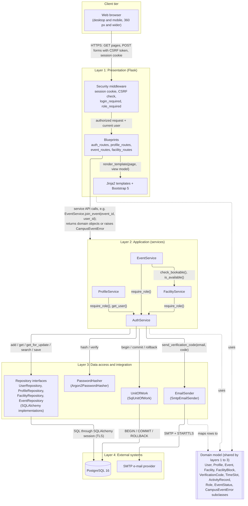
*Files: [png](design/arch/layered_architecture.png), [svg](design/arch/layered_architecture.svg), [source](design/arch/layered_architecture.mmd)*

### 3.2 Interfaces between the layers
Every arrow of the architecture diagram is labelled with the interface it uses:

| From → to | Interface | Data passed |
|---|---|---|
| Browser → Presentation | HTTPS: `GET` pages, `POST` forms | Form fields, CSRF token, signed session cookie; HTML pages back |
| Security middleware → Blueprints | Flask request context | Authorized request and the current user (`login_required`, `role_required`) |
| Blueprints → Templates | `render_template(page, view_model)` | View models without e-mail addresses (NFR-05) |
| Presentation → Application | Public service methods, e.g. `EventService.join_event(event_id, user_id)` | Primitive values and `TimeSlot`; returns domain objects or raises a `CampusEventError` subclass |
| Application → Application | `AuthService.require_role()`, `AuthService.get_user()`, `FacilityService.check_bookable()`, `FacilityService.is_available()` | User ids, roles, facility id and slot |
| Application → Data access | Repository methods (`add`, `get`, `get_for_update`, `search`, `save`, …), `UnitOfWork.begin/commit/rollback`, `PasswordHasher.hash/verify`, `EmailSender.send_verification_code` | Domain objects and ids |
| Data access → PostgreSQL | SQL through one SQLAlchemy session per request (psycopg, TLS) | Rows; `SELECT … FOR UPDATE` for locks |
| Data access → SMTP provider | SMTP with STARTTLS | Verification e-mail |

### 3.3 Components
| Layer | Component | Responsibility | Use cases |
|---|---|---|---|
| Presentation | `auth_routes` | Sign up, verification, log in, log out | UC-01, UC-02 |
| Presentation | `profile_routes` | My Profile page | UC-03 |
| Presentation | `event_routes` | Find events, event details, create, join, leave, cancel, My Activities | UC-04 to UC-07, UC-09 to UC-11 |
| Presentation | `facility_routes` | Facility management (staff only) | UC-07, UC-08 |
| Presentation | Security middleware | Session handling, CSRF, `login_required`, `role_required` decorators | all |
| Application | `AuthService` | Registration, e-mail verification, login, roles | UC-01, UC-02 |
| Application | `ProfileService` | Interests and availability | UC-03 |
| Application | `EventService` | Event life cycle and search, activity history | UC-04 to UC-06, UC-09 to UC-11 |
| Application | `FacilityService` | Facilities, blocks, schedules, conflict check | UC-07, UC-08 |
| Data access and integration | `UserRepository`, `ProfileRepository`, `FacilityRepository`, `EventRepository` (`Sql*` and `InMemory*` implementations) | Storing and reading domain objects, row locks | all |
| Data access and integration | `UnitOfWork` (`SqlUnitOfWork`, `InMemoryUnitOfWork`) | Transactions; one SQLAlchemy session shared by all repositories of a request | all writing use cases |
| Data access and integration | `PasswordHasher` (`Argon2PasswordHasher`) | Hashing passwords and verification codes | UC-01, UC-02 |
| Data access and integration | `EmailSender` (`SmtpEmailSender`, `InMemoryEmailSender`) | Sending verification codes | UC-01 |
| External systems | PostgreSQL 16, SMTP provider | Storage, e-mail delivery | all |
| Shared domain model | `models.py`, `exceptions.py` | Entities, value objects, enums, domain errors | all |

### 3.4 Deployment
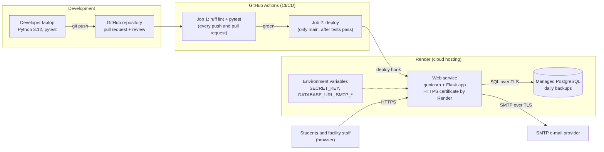
*Files: [png](design/arch/deployment.png), [svg](design/arch/deployment.svg), [source](design/arch/deployment.mmd)*

Every push and pull request runs `ruff` and `pytest` in GitHub Actions. Only a green build on `main` triggers the Render deploy hook. Secrets (`SECRET_KEY`, `DATABASE_URL`, `SMTP_*`) exist only as environment variables on Render and as GitHub Actions secrets; they are never committed. `.env` is listed in `.gitignore`; the repository will only contain an `.env.example` with empty values.

### 3.5 Project structure
```
src/campusevent/
    web/                               layer 1: Flask app factory, blueprints, templates, static files
    auth.py, profiles.py,
    events.py, facilities.py           layer 2: application services
    repositories/                      layer 3: repository and UnitOfWork interfaces, SQL and in-memory versions
    security.py                        layer 3: PasswordHasher interface, Argon2PasswordHasher
    notifications.py                   layer 3: EmailSender interface, SmtpEmailSender, InMemoryEmailSender
    models.py, exceptions.py           shared domain model
    app.py                             composition root: chooses the implementations and wires the services
migrations/                            Alembic migrations
tests/                                 requirement tests (pytest)
```

---

## 4. Class Design

### 4.1 Domain classes
The domain classes are the ones already in [`models.py`](../src/campusevent/models.py). `Event` gets two helper methods (`free_places`, `is_active`) that the services use for the capacity and conflict rules. All domain errors derive from `CampusEventError`, so the presentation layer can map them to user messages in one place.

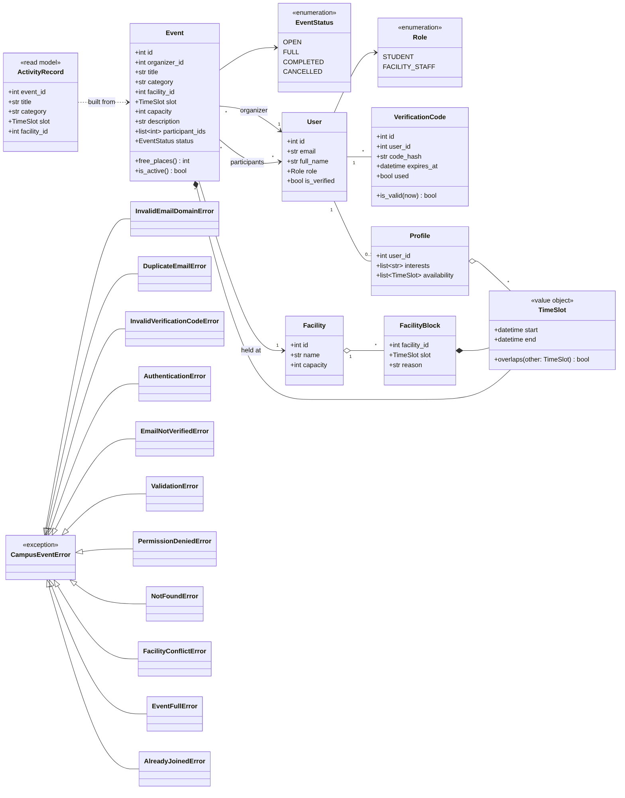
*Files: [png](design/class/domain_classes.png), [svg](design/class/domain_classes.svg), [source](design/class/domain_classes.mmd)*

### 4.2 Services and the interfaces they use
The service classes keep the public methods of the skeleton (which the tests call). Each service depends only on other services and on the layer 3 interfaces; the dependencies are passed in through the constructor (dependency injection). `EventService` does not use `FacilityRepository` directly: it asks `FacilityService.check_bookable()`, which owns all facility rules (capacity, blocks, overlaps).

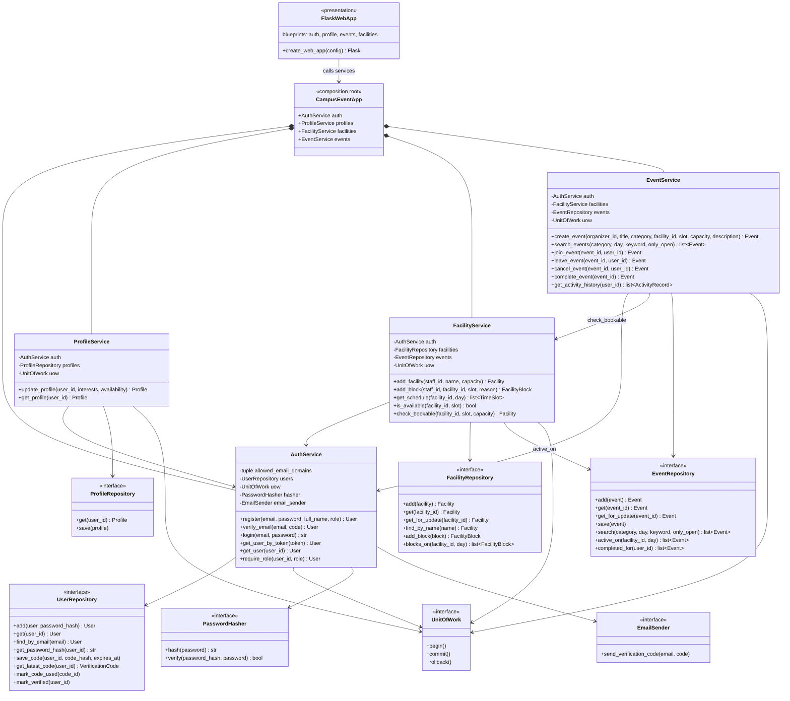
*Files: [png](design/class/service_layer.png), [svg](design/class/service_layer.svg), [source](design/class/service_layer.mmd)*

### 4.3 Implementations of the data access and integration layer
`create_app` in `app.py` is the only place that chooses the concrete classes: production uses the `Sql*` classes, `SqlUnitOfWork`, `Argon2PasswordHasher` and `SmtpEmailSender`; the tests use the `InMemory*` classes and `InMemoryEmailSender`. All SQL classes of one request share one SQLAlchemy `Session`, so the repositories take part in the transaction that `UnitOfWork` opened.

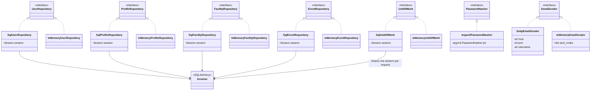
*Files: [png](design/class/data_access_implementations.png), [svg](design/class/data_access_implementations.svg), [source](design/class/data_access_implementations.mmd)*

### 4.4 Design principles applied
| Principle | Where |
|---|---|
| Single responsibility | One service per business area; routes only translate HTTP to service calls |
| Dependency inversion | Services depend on the layer 3 interfaces (`*Repository`, `UnitOfWork`, `PasswordHasher`, `EmailSender`), not on SQLAlchemy, argon2 or SMTP |
| Strict layering | Every call goes to the layer directly below (section 3.1); checked in every sequence diagram |
| Information expert | `TimeSlot.overlaps` decides overlaps; `Event.free_places` decides capacity |
| Fail fast | Services validate input and raise a domain error before any data is changed |

---

## 5. Object Interactions (Sequence Diagrams)

Six design-level sequence diagrams show the messages between the real classes and methods of section 4. The participants are grouped in boxes by layer (section 3.1); every arrow goes from a layer to the same layer or to the layer directly below, and only layer 3 components send messages to PostgreSQL or the SMTP provider. Together they cover **9 of 11 use cases (82 %)**; the remaining two (UC-03 manage profile, UC-09 activity history) are simple read/update flows already shown at analysis level in the Requirement Analysis Report, section 4.6.

| Diagram | Use cases |
|---|---|
| [Register and verify](design/sequence/uc01_register_and_verify.png) | UC-01 |
| [Log in](design/sequence/uc02_login.png) | UC-02 |
| [Create event with conflict check](design/sequence/uc04_uc07_create_event.png) | UC-04, UC-07 |
| [Browse, filter and join](design/sequence/uc05_uc06_browse_and_join.png) | UC-05, UC-06 |
| [Manage facility schedule](design/sequence/uc08_manage_facility_schedule.png) | UC-08 |
| [Leave and cancel](design/sequence/uc10_uc11_leave_and_cancel.png) | UC-10, UC-11 |

### 5.1 UC-01 Register and verify
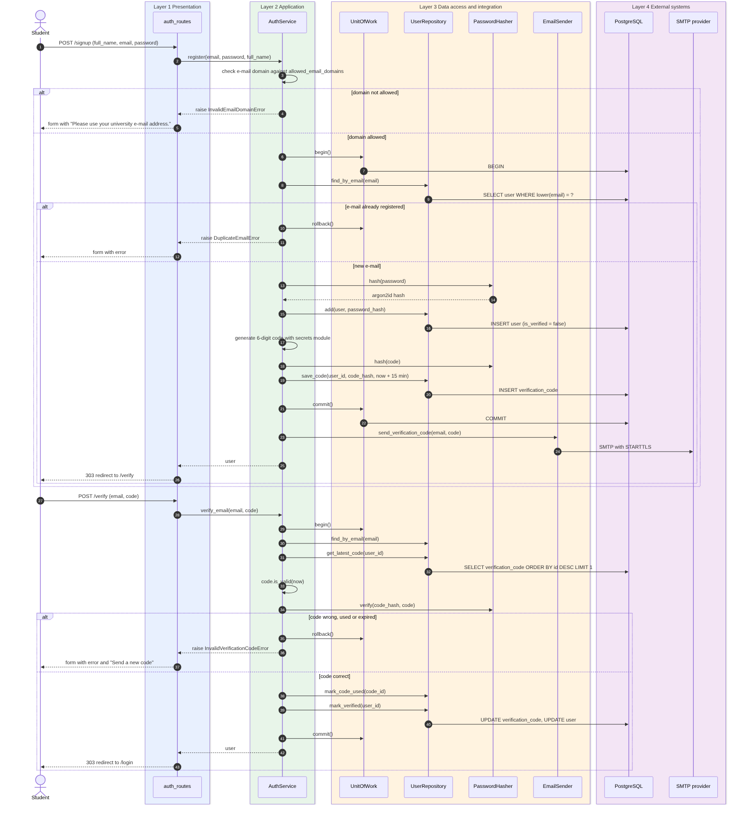

### 5.2 UC-02 Log in
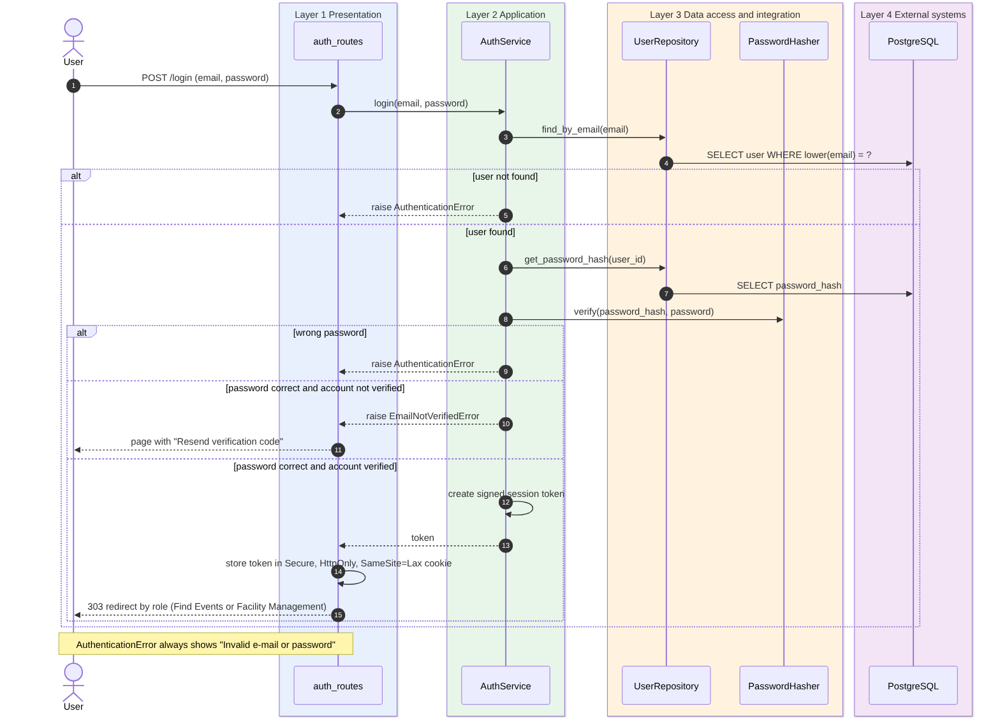

### 5.3 UC-04 and UC-07 Create an event with conflict check
`EventService` opens the transaction through `UnitOfWork` and asks `FacilityService.check_bookable()`. `FacilityRepository.get_for_update()` locks the facility row (`SELECT … FOR UPDATE`) before the availability check, so two students cannot book the same slot at the same moment (risk R-01 of the analysis).

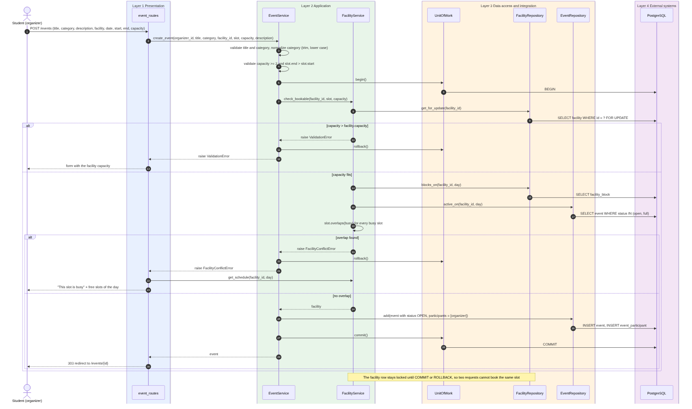

### 5.4 UC-05 and UC-06 Browse, filter and join
`EventRepository.get_for_update()` locks the event row inside the `UnitOfWork` transaction, so the number of participants never exceeds the capacity (BR-07).

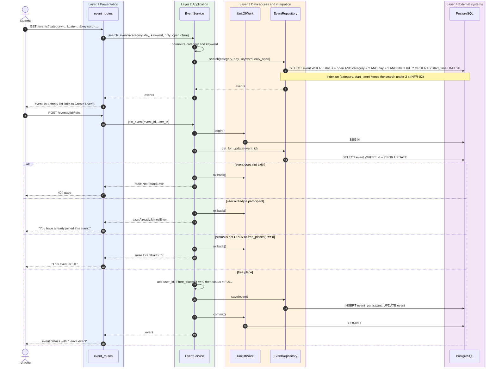

### 5.5 UC-08 Manage facility schedule
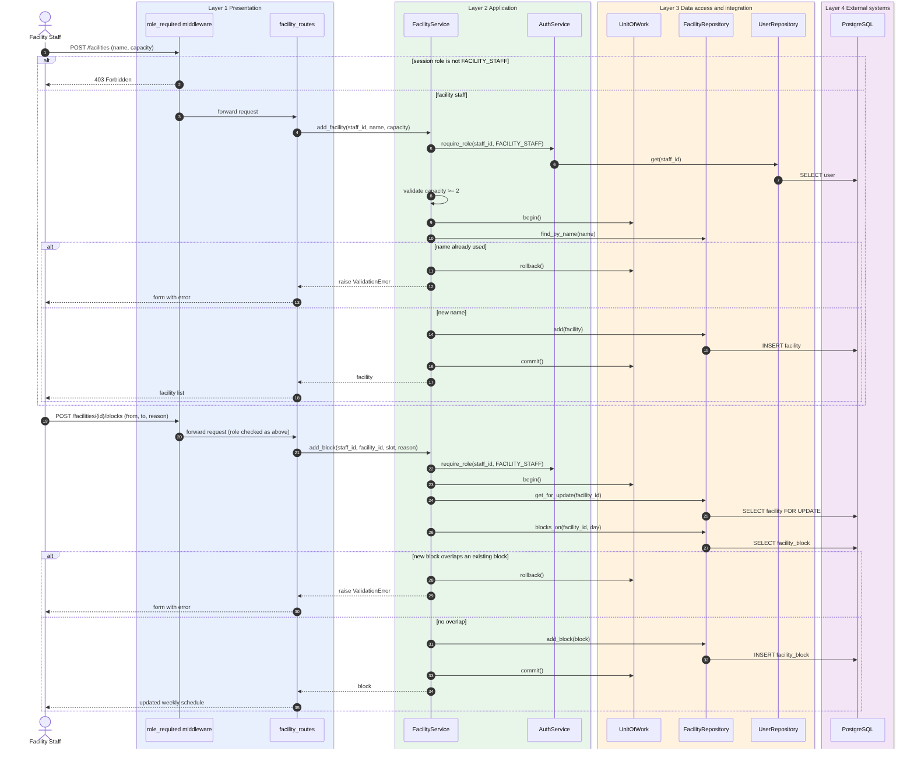

### 5.6 UC-10 and UC-11 Leave and cancel an event
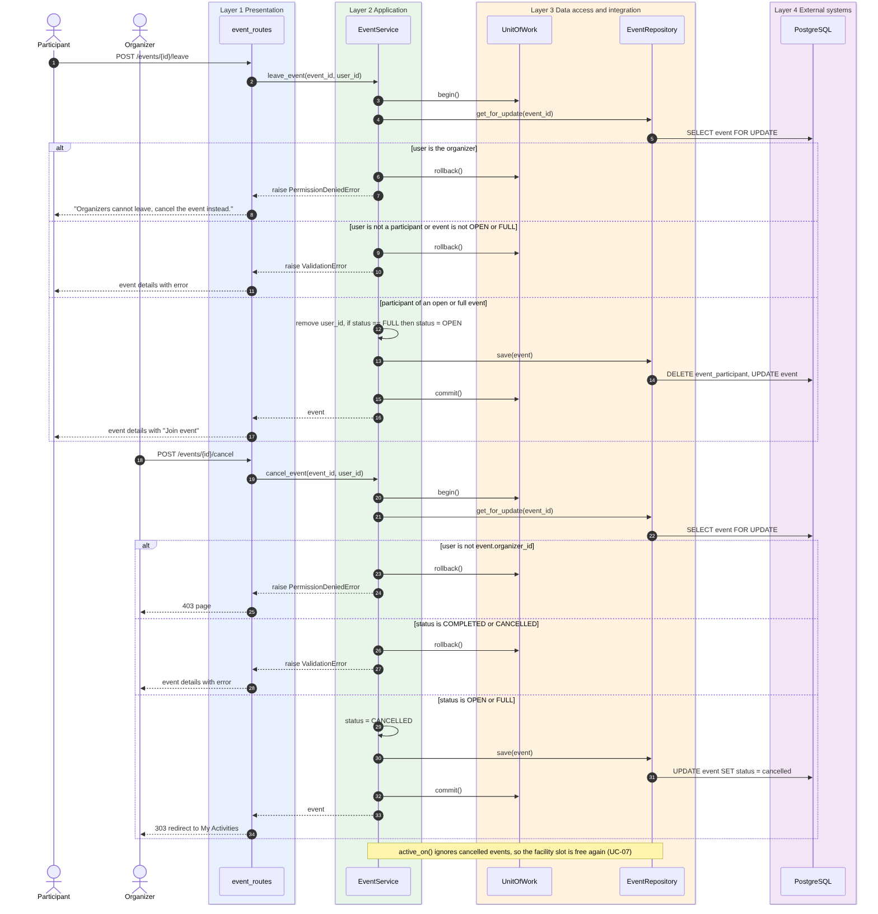

---

## 6. Data Design

The tables follow the E-R diagram of the Requirement Analysis Report (section 3.1): `user`, `verification_code`, `profile_interest`, `availability_slot`, `facility`, `facility_block`, `event`, `event_participant`. Design additions:

| Table | Constraint or index | Purpose |
|---|---|---|
| `user` | `UNIQUE (lower(email))` | No duplicate accounts (UC-01) |
| `verification_code` | `code_hash`, `expires_at`, `used` | Codes are stored hashed and expire after 15 minutes |
| `event` | `CHECK (capacity >= 2)`, `CHECK (end_time > start_time)` | BR-04 |
| `event` | Index on `(category, start_time)` and on `(facility_id, start_time)` | Fast search (NFR-02) and fast conflict check (UC-07) |
| `event_participant` | Primary key `(event_id, user_id)` | A user joins an event once (BR-07) |
| `facility` | `CHECK (capacity >= 2)`, `UNIQUE (name)` | UC-08 |

Categories and interests are stored trimmed and in lower case (BR-14). All times are stored in UTC and shown in Europe/Istanbul. Schema changes are made only through Alembic migrations, which are reviewed in pull requests like any other code.

---

## 7. Design Decisions for the Non-Functional Requirements

| NFR | Requirement | Design decision | Tool | How it is checked |
|---|---|---|---|---|
| NFR-01 Usability | Responsive from 360 px to desktop | Mobile-first templates with the Bootstrap 5 grid; one column below 576 px; touch-sized buttons; same pages for all devices (no separate mobile app) | Bootstrap 5, Jinja2 base template | Manual check of every page at 360 px and desktop width in the browser developer tools; mockup 09 of the analysis is the reference |
| NFR-02 Performance | Event search < 2 s for 1,000 open events | Filtering in SQL inside `EventRepository.search`, not in Python; indexes on `(category, start_time)` and `(facility_id, start_time)`; pagination of 20 events per page; no N+1 queries (participant counts loaded with one aggregate query) | PostgreSQL indexes, SQLAlchemy `selectinload` | `test_nfr02_search_is_fast_with_1000_open_events`; `EXPLAIN ANALYZE` on the search query before release |
| NFR-03 Security | Salted password hashes, HTTPS | Passwords hashed with argon2id by `Argon2PasswordHasher` (random salt per password); verification codes stored as hashes; HTTPS enforced by Render and `SESSION_COOKIE_SECURE=True`; `HttpOnly` and `SameSite=Lax` cookies; CSRF token on every form; secrets only in environment variables | argon2-cffi, Flask-WTF, Render TLS, GitHub secret scanning | `test_nfr03_*` (2 tests); HTTPS checked after deployment |
| NFR-04 Security | Role-based access | Two checks: `role_required` decorator on routes (returns 403) **and** `AuthService.require_role` inside the services, so a rule cannot be skipped by calling a service from another route; only the organizer can cancel (checked in `EventService`) | Flask decorators, domain exceptions | `test_nfr04_*` (3 tests) |
| NFR-05 Privacy | Only needed data shown, KVKK | Templates receive view models that contain no e-mail address; the participant list shows names only; availability is private (F-08); data minimization in the database (no phone, no student number) | Jinja2 view models | Manual review of event and participant pages |
| NFR-06 Maintainability | Tests for each use case, one command | Strict layering with injected layer 3 interfaces makes services testable without a database (in-memory implementations); `python -m pytest` runs everything; CI blocks merging when tests or lint fail | pytest, ruff, GitHub Actions, branch protection on `main` | CI status on every pull request |
| NFR-07 Portability | Chrome, Firefox, Safari, Edge | Only standard HTML5, CSS and ES2020 JavaScript; Bootstrap 5 supports all four browsers; no browser plug-ins | Bootstrap 5 | Manual check of the main pages in each browser before release |

### 7.1 Concurrency (supports NFR-02 and the business rules)
Booking a facility (UC-04) and joining an event (UC-06) are the two places where simultaneous requests can break a rule. Both run in one transaction opened by the service through `UnitOfWork.begin()`; inside it the repository locks the facility or event row with `get_for_update()` (`SELECT … FOR UPDATE`). Any domain error leads to `UnitOfWork.rollback()`, so no partial data is stored. The database constraints of section 6 are the last line of defence if application code has a bug.

### 7.2 Error handling
Services raise domain exceptions (`ValidationError`, `FacilityConflictError`, `EventFullError`, …). One Flask error handler maps them to the user messages written in the use cases and to HTTP status codes (400, 403, 404, 409). Unexpected errors are logged and the user sees a generic error page without technical details.

---

## 8. Decisions on Open Findings of the Analysis

| Finding | Decision in design |
|---|---|
| F-04 Free-text categories fragment the list | Categories are normalized (trim, lower case); the Create Event form suggests existing categories with an HTML `datalist` |
| F-05 Password reset is missing | Out of scope for the codebase deadline; documented as a future use case |
| F-06 Python and Java in the charter | Python only (section 2); the charter's technology stack was updated accordingly |
| F-07 Chat wording in the charter | Chat is out of scope; the charter's out-of-scope list was corrected |
| F-08 Public profile | Public profile shows name and interests only; availability stays private |
| F-09 Upcoming events | My Activities page gets an "Upcoming" tab next to "History" (same service, filter by status) |

---

## 9. Traceability: Use Case to Design Elements

| Use case | Route (layer 1) | Service methods (layer 2) | Layer 3 interfaces | Sequence |
|---|---|---|---|---|
| UC-01 | `auth_routes` `/signup`, `/verify` | `AuthService.register`, `verify_email` | `UserRepository`, `UnitOfWork`, `PasswordHasher`, `EmailSender` | 5.1 |
| UC-02 | `auth_routes` `/login` | `AuthService.login` | `UserRepository`, `PasswordHasher` | 5.2 |
| UC-03 | `profile_routes` `/profile` | `ProfileService.update_profile`, `get_profile` | `ProfileRepository`, `UnitOfWork` | analysis 4.6 |
| UC-04 | `event_routes` `/events` (POST) | `EventService.create_event`, `FacilityService.check_bookable` | `EventRepository`, `FacilityRepository`, `UnitOfWork` | 5.3 |
| UC-05 | `event_routes` `/events` (GET) | `EventService.search_events` | `EventRepository` | 5.4 |
| UC-06 | `event_routes` `/events/{id}/join` | `EventService.join_event` | `EventRepository`, `UnitOfWork` | 5.4 |
| UC-07 | `facility_routes`, used by UC-04 | `FacilityService.check_bookable`, `is_available`, `get_schedule` | `FacilityRepository`, `EventRepository` | 5.3 |
| UC-08 | `facility_routes` `/facilities`, `/facilities/{id}/blocks` | `FacilityService.add_facility`, `add_block`, `AuthService.require_role` | `FacilityRepository`, `UserRepository`, `UnitOfWork` | 5.5 |
| UC-09 | `event_routes` `/activities` | `EventService.get_activity_history` | `EventRepository` | analysis 4.6 |
| UC-10 | `event_routes` `/events/{id}/leave` | `EventService.leave_event` | `EventRepository`, `UnitOfWork` | 5.6 |
| UC-11 | `event_routes` `/events/{id}/cancel` | `EventService.cancel_event` | `EventRepository`, `UnitOfWork` | 5.6 |

---

## 10. Implementation Plan
The implementation follows the [project plan](plan/README.md): DB integration (3.1) starts on 16.11.2026, followed by the backend slices (3.2 accounts and profiles, 3.3 facilities, 3.4 events), the web UI (3.5, 3.6) and the CI/CD pipeline (3.7), which can start in parallel. High priority use cases (UC-01 to UC-07) are implemented first. A use case is done when its requirement tests pass in CI.

---

## 11. Consistency Check between the Design Diagrams
After the review of version 1.0 all diagrams were compared with each other and with the code skeleton. The differences found and how they were fixed:

| # | Difference found in version 1.0 | Fix in version 1.1 |
|---|---|---|
| 1 | The report said each layer only calls the layer below, but the sequence diagrams had services sending `BEGIN`, `COMMIT` and `ROLLBACK` to PostgreSQL directly | New `UnitOfWork` interface in layer 3; services call `begin()`, `commit()`, `rollback()`; only `SqlUnitOfWork` talks to PostgreSQL |
| 2 | Services called `PasswordHasher` and `EmailSender`, which the architecture diagram placed two layers below them | Both are now interfaces of layer 3 (data access and integration) with implementations `Argon2PasswordHasher` and `SmtpEmailSender`; the layering rule is stated precisely in section 3.1 |
| 3 | The arrows of the architecture diagram had no labels | Every arrow is labelled with its interface; section 3.2 lists them in a table |
| 4 | In the create-event sequence `EventService` used `FacilityRepository` directly, but the class diagram had no such dependency | `EventService` now calls `FacilityService.check_bookable()`, which uses `FacilityRepository` (sequence 5.3 and class diagram 4.2 agree) |
| 5 | `FacilityService` used `EventRepository` in the class diagram but not in the architecture diagram | Layer 2 → layer 3 arrows now cover all repositories; the dependency is labelled `active_on` in the class diagram |
| 6 | Sequence diagrams called methods missing from the class diagram (latest verification code, mark code used, password hash, facility name check, facility lock) | Added `get_latest_code`, `mark_code_used`, `get_password_hash`, `find_by_name`, `get_for_update`, `AuthService.get_user` to the class diagram |
| 7 | Sequence diagrams raised errors that the domain class diagram did not show (`InvalidEmailDomainError`, `DuplicateEmailError`, `InvalidVerificationCodeError`, `NotFoundError`) | Domain class diagram now lists all errors of [`exceptions.py`](../src/campusevent/exceptions.py) |
| 8 | Verification codes were used in the sequences but `VerificationCode` was missing from the domain class diagram (it exists in the analysis E-R model) | `VerificationCode` added to the domain class diagram |
| 9 | Sequences named concrete classes (`SqlUserRepository`) while the class diagram said services depend on interfaces | Sequences now use the interface names; implementations are shown in the new class diagram 4.3 |
| 10 | The search sequence filtered `status IN (open, full)` although `search_events(only_open=True)` returns open events only (UC-05) | The search filters `status = open`; `active_on` (conflict check) still counts open and full events |

Checks done for version 1.1: every participant of every sequence diagram exists in a class diagram; every message between classes is a method of the receiving class; every arrow in a sequence goes to the same layer or the layer directly below; every dependency in the class diagrams appears as a labelled arrow (or a group arrow) in the architecture diagram.
