# CampusEvent – UI/UX Design (task 2.3)

| Field | Value |
|---|---|
| Task | 2.3 UI/UX Design (owners: E. Arda & Emir; this version written by Emir) |
| Version | 1.0, 20.11.2026 |
| Status | Describes the web UI as built (PR #7, #14) with the visual refresh of PR #20 (all merged) |
| Builds on | [Requirements Specification](requirements_specification.md), [use cases](requirements/README.md), [early mockups](analysis/ui/README.md) of the Requirement Analysis Report, [Software Design Report](software_design_report.md) (layer 1) |
| Code | [`src/campusevent/web/`](../src/campusevent/web/README.md) |
| Screens | [`docs/design/ui/`](design/ui/) (taken from the demo, `scripts/run_demo.py`, on 19.11.2026) |

The facility staff page (UC-07, UC-08, task 3.6, Harun) is described in its own PR (#15) and is not covered here beyond the navigation.

## Contents
1. [Users and their goals](#1-users-and-their-goals)
2. [Design principles](#2-design-principles)
3. [Information architecture and navigation](#3-information-architecture-and-navigation)
4. [Key user flows](#4-key-user-flows)
5. [Screens](#5-screens)
6. [Visual design system](#6-visual-design-system)
7. [Interaction and feedback](#7-interaction-and-feedback)
8. [Accessibility, responsiveness and browsers](#8-accessibility-responsiveness-and-browsers)
9. [Privacy in the interface](#9-privacy-in-the-interface)
10. [From the early mockups to the final design](#10-from-the-early-mockups-to-the-final-design)
11. [Usability evaluation](#11-usability-evaluation)
12. [Open points](#12-open-points)
13. [Traceability](#13-traceability)

---

## 1. Users and their goals
| User | Typical situation | Main goals | Use cases |
|---|---|---|---|
| **Student (participant)** | Has a free evening and wants to do something with other students | Find an event quickly, join with one click, leave if plans change, add it to the own calendar | UC-01, UC-02, UC-03, UC-05, UC-06, UC-09, UC-10 |
| **Student (organizer)** | Wants a football match or a study group but needs a place and people | Pick a facility and a free time without trial and error, see if the request is approved, fix a rejected request | UC-04, UC-07 (read), UC-11, UC-12 (organizer view) |
| **Admin** | Checks new events before they are public (CR-01) | See all waiting requests in one list, approve or reject with a reason | UC-12 |
| **Facility staff** | Runs the halls and courts | Add facilities, block times for classes or maintenance | UC-07, UC-08 (task 3.6) |

Most students open the site on a **phone** between classes, so every screen is designed for a 360 px wide screen first and then widened for desktop (NFR-01).

## 2. Design principles
1. **One clear next step per screen.** Each page has one main action in the accent colour (*Join*, *Create event*, *Log in*, *Approve*). Other actions are quieter.
2. **Prevent errors instead of reporting them.** The create form shows the facility's busy and free times while the user types, suggests free slots, warns about overlaps before submitting and limits the capacity to the facility.
3. **Say what happened, in plain words.** Every action ends with a short message ("You joined the event.", "Your request is sent. An admin reviews it …"). Error messages say how to fix the problem and keep the typed values.
4. **Same layout everywhere.** One base template, one menu per role, one card style, one colour for one meaning (green = open/free, red = busy/rejected, blue = waiting).
5. **Accessible by default.** Text contrast at least 4.5:1, touch targets at least 40 px, labels on every field, no information shown by colour only, motion that can be switched off.
6. **Privacy first.** Pages show names only, never e-mail addresses; requests that are not public are visible only to their organizer (NFR-05, BR-15).

## 3. Information architecture and navigation
Every role lands on its own start page after login, and the menu shows only the pages that role may use. Pages of other roles answer with *403* (NFR-04).

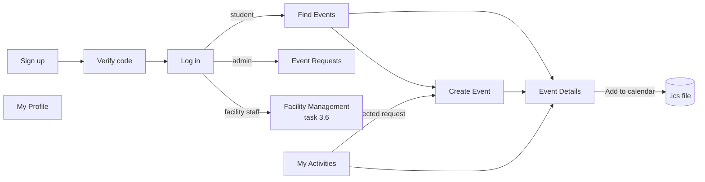

| Role | Menu | User menu |
|---|---|---|
| Student | Find Events · Create Event · My Activities | name · My Profile · Log out |
| Admin | Event Requests | name · Log out |
| Facility staff | Facilities | name · Log out |

The menu is a sticky bar at the top. On phones it collapses into a menu button.

## 4. Key user flows

### 4.1 Find and join an event (UC-05, UC-06, UC-10)
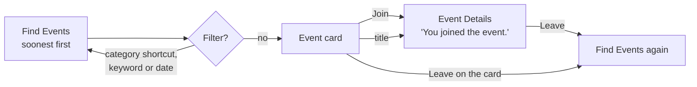
One click joins from the list; the student lands on the event page, where the event can be added to the calendar. Leaving is possible from the card (the list comes back with the same filters) or from the event page.

### 4.2 Organize an event (UC-04, UC-07, UC-12)
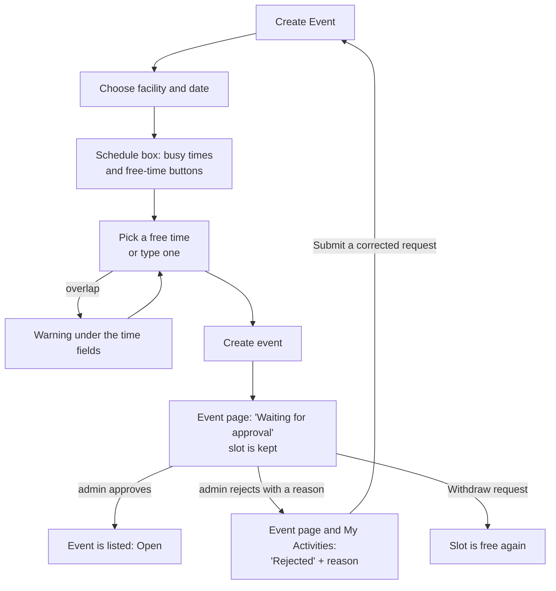

### 4.3 Review requests (UC-12)
The admin sees all waiting requests, soonest first, with everything needed for a decision on one card (title, category, time, facility, organizer, capacity, description). *Approve* takes one click. *Reject* opens a reason box; the reason is required (max. 500 characters) and is shown to the organizer.

### 4.4 Sign up and first log in (UC-01, UC-02)
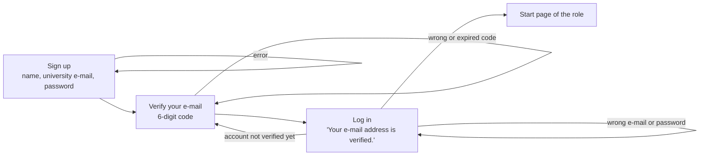
The e-mail address is not put into the address of the verify page, so it does not end up in server logs. After login every role starts on its own page (section 3).

## 5. Screens
Screens of the student, then the admin. All screenshots are from the demo with the default background.

### 5.1 Log in and sign up (UC-01, UC-02)
| Log in | Sign up |
|---|---|
| 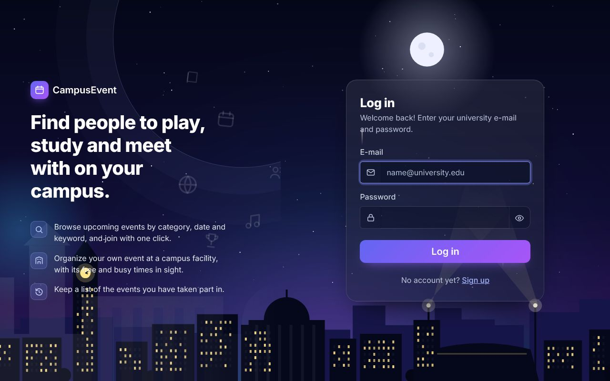 | 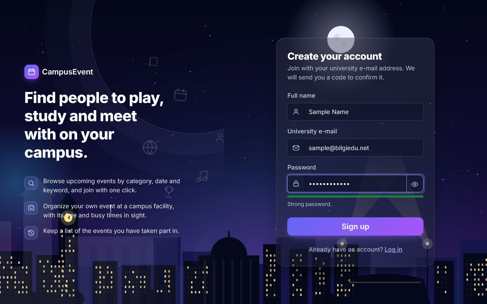 |

- Brand panel on the left (what CampusEvent does, in three points), form on a glass card on the right; on phones only the card.
- *Show password* button on every password field; the sign-up page shows a **password strength guide** while typing.
- Sign-up continues on a separate *Verify your e-mail* step for the 6-digit code ([screen](design/ui/03_verify_code.jpg)).
- A failed login says only "Invalid e-mail or password", so the page does not reveal which accounts exist ([screen](design/ui/04_log_in_error.jpg)). An unverified account is offered the code page instead.

### 5.2 Find Events (UC-05, UC-06)
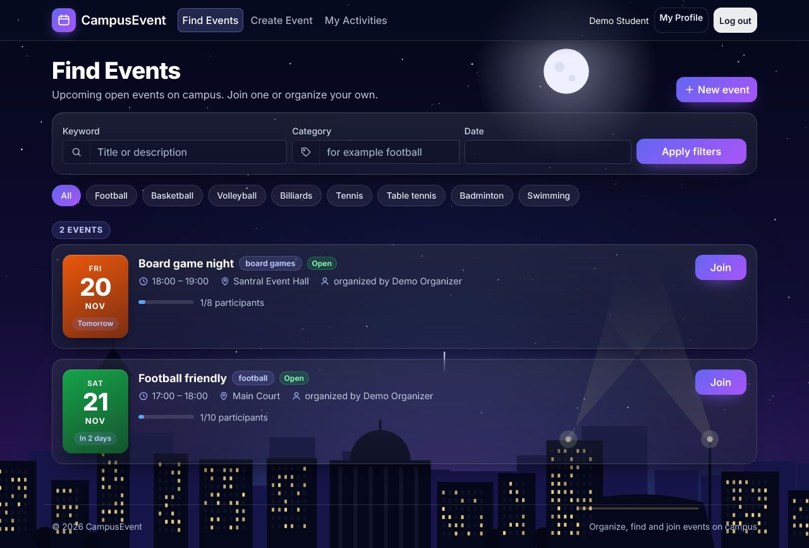

- **Filters:** keyword, category (with suggestions), date. Under them **category shortcuts** filter with one click; *Clear all filters* appears only when a filter is set ([filtered](design/ui/06_find_events_filtered.jpg)).
- **Event card:** a coloured **date tile** (weekday, day, month, "Tomorrow" / "In 3 days"), the title, category and status, time, facility, organizer and a participant bar.
- **Date tile colour = category.** All events of one category share a colour, so a long list is easy to scan. The colour only helps scanning; on Find Events, Event Requests and the activity history the category is also written on the card.
- 20 events per page (NFR-02); the pagination keeps the filters.
- Empty result: a friendly message and a *Create an event* button.
- Joined events show *You joined* and a red **Leave** button of the same height ([screen](design/ui/08_find_events_joined_card.jpg)).

### 5.3 Event Details (UC-06, UC-10, UC-11)
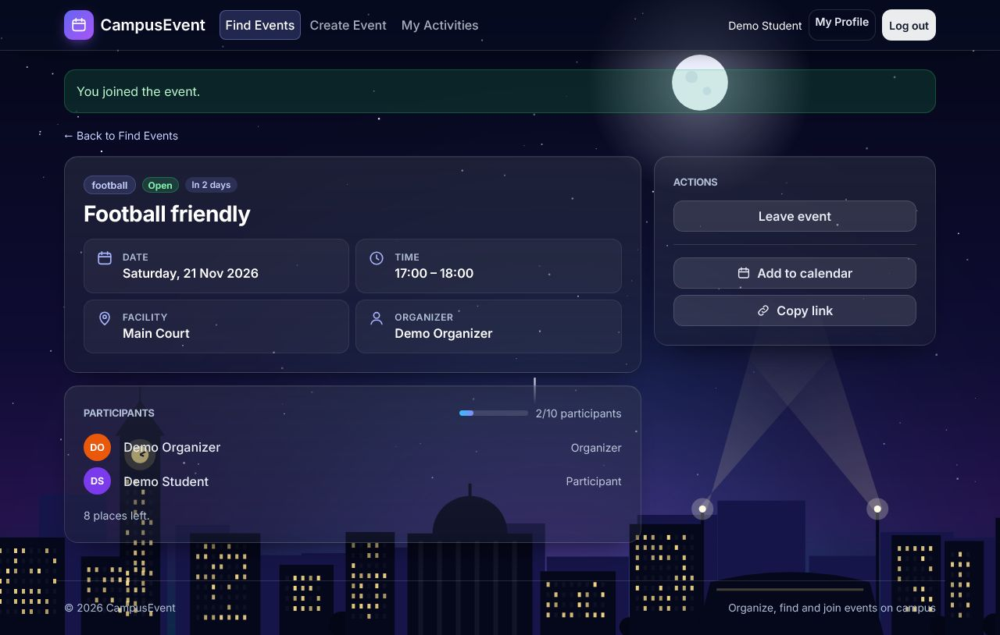

- Four info tiles (date, time, facility, organizer), the description, and the participants with initials avatars (names only).
- Action panel: *Join event* / *Leave event* / *Cancel event* depending on the role in the event, then **Add to calendar** (an `.ics` file in UTC, so every calendar shows the right time) and **Copy link**.
- **Cancel** and **Withdraw** ask for confirmation in a dialog that says what will happen ([screen](design/ui/10_withdraw_dialog.jpg)).
- For the organizer of a request, a coloured note explains the state:

| Waiting for approval | Rejected |
|---|---|
| 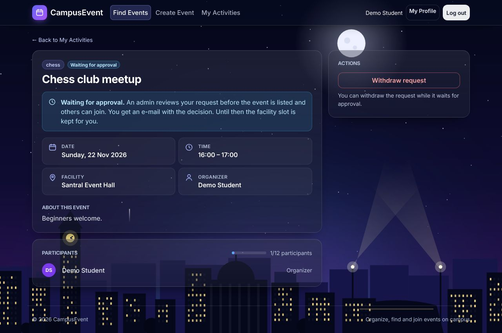 | 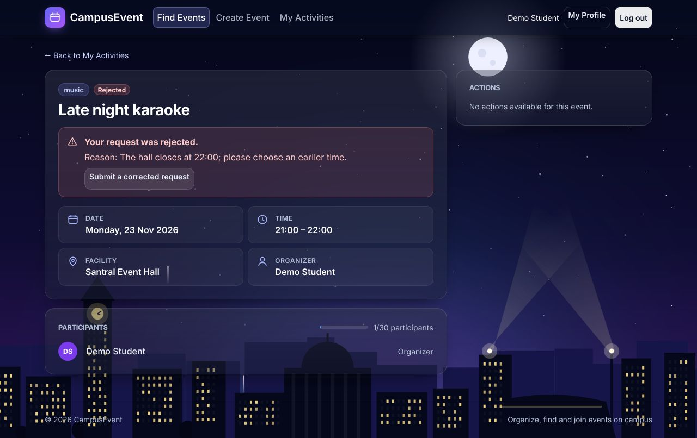 |

### 5.4 Create Event (UC-04, UC-07)
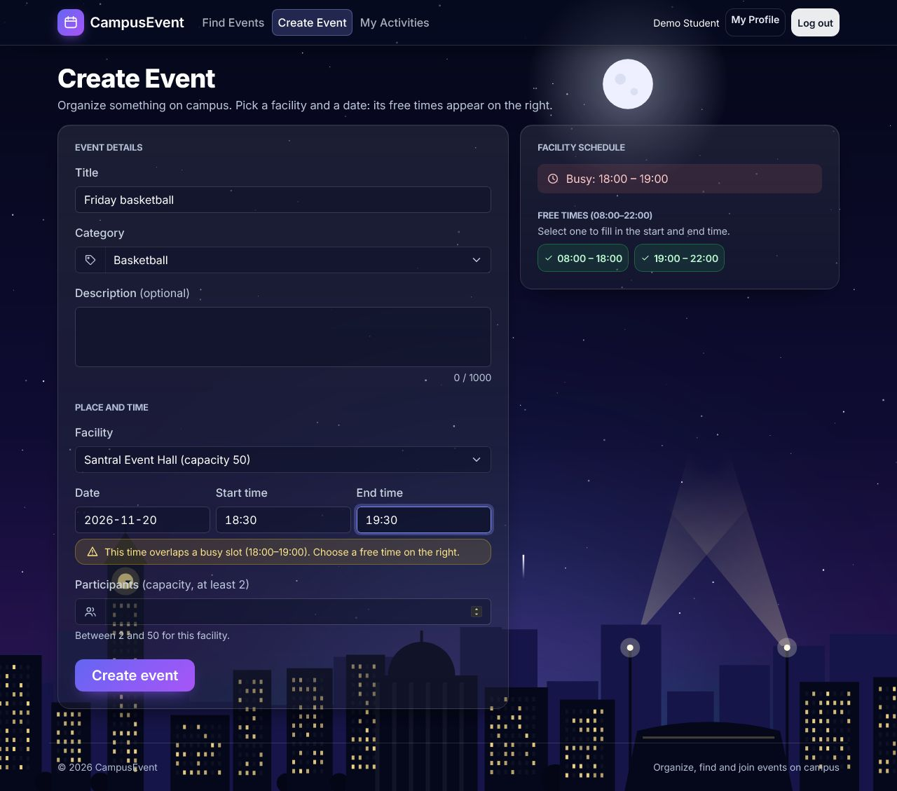

- Two sections: *Event details* (title, category from a list with *Other…* for free text, description with a character counter) and *Place and time*.
- The **facility schedule** box on the right loads as soon as a facility and a complete date are chosen: busy times in red and **free-time buttons** in green (gaps of at least one hour between 08:00 and 22:00). One click on a free time fills both time fields.
- An **overlap warning** appears under the time fields while typing, before anything is sent.
- The capacity field shows the allowed range for the chosen facility ("Between 2 and 50 for this facility").
- If the server still finds a conflict (someone booked the slot meanwhile), the page comes back with the message, the entered data and the free times of that day (UC-04 4a).

### 5.5 My Profile (UC-03)
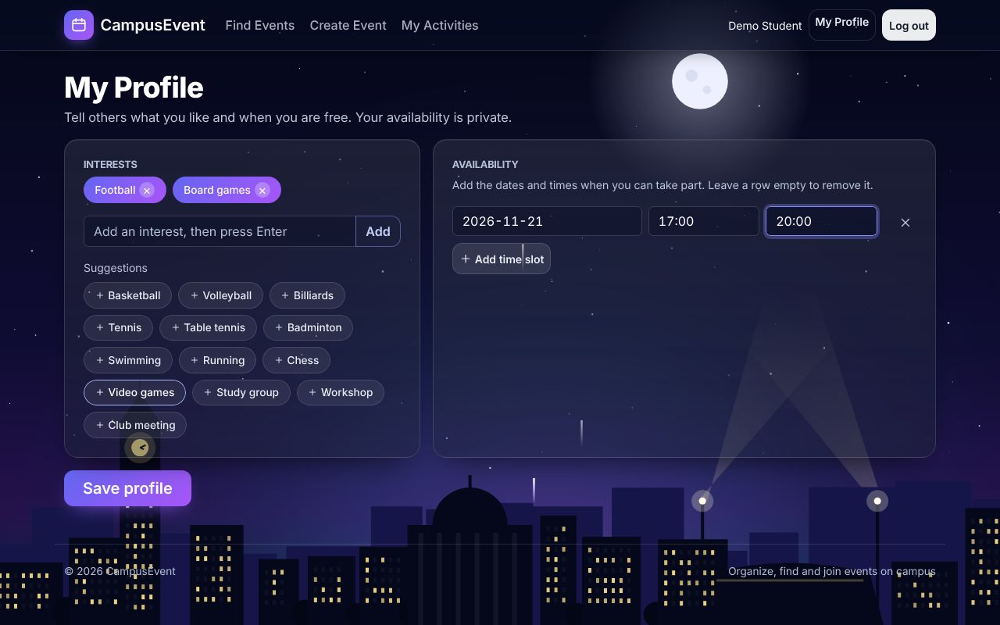

Interests are tags: type and press Enter, or click a suggestion; × removes a tag. Availability is a list of date and time rows that can be added and removed. The page needs at least one interest and refuses a slot that ends before it starts.

### 5.6 My Activities (UC-09, organizer view of UC-12)
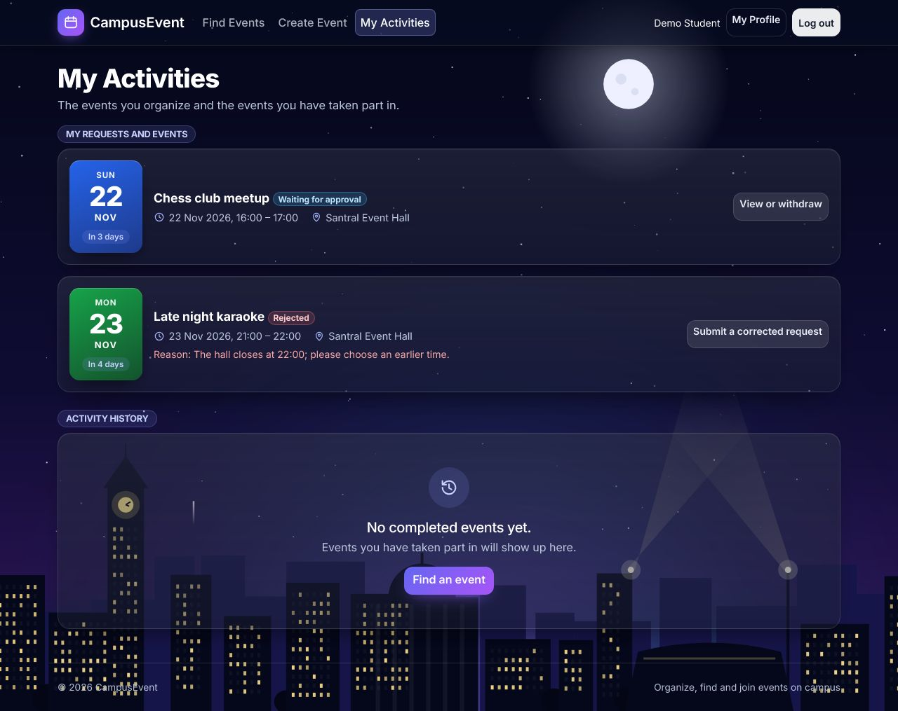

Two sections: **My requests and events** (everything the student organizes, waiting and rejected first, with the reason and a *Submit a corrected request* / *View or withdraw* button) and **Activity history** (completed events, newest first).

### 5.7 Event Requests (admin, UC-12)
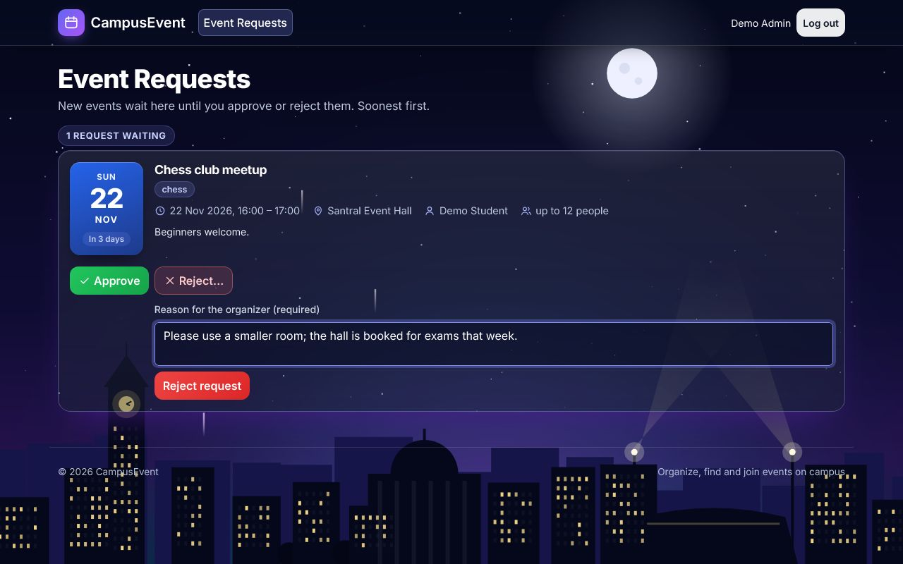

The reject box opens under the card; an empty reason is refused by the browser and again by the server. After a decision the list updates and a message confirms it ("… is approved. It is now listed and students can join it.").

### 5.8 Phone (360 px)
| Log in | Find Events | Event details | Menu |
|---|---|---|---|
| 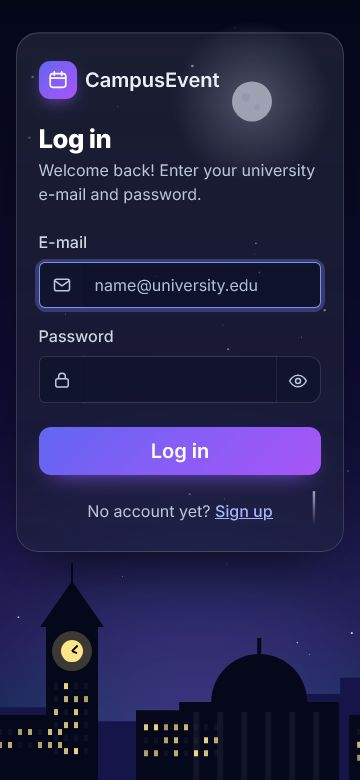 | 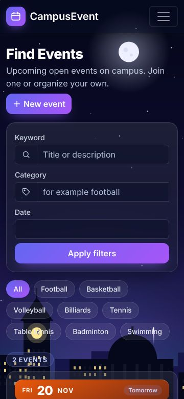 | 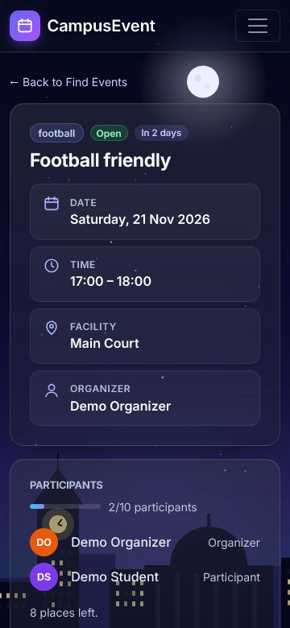 | 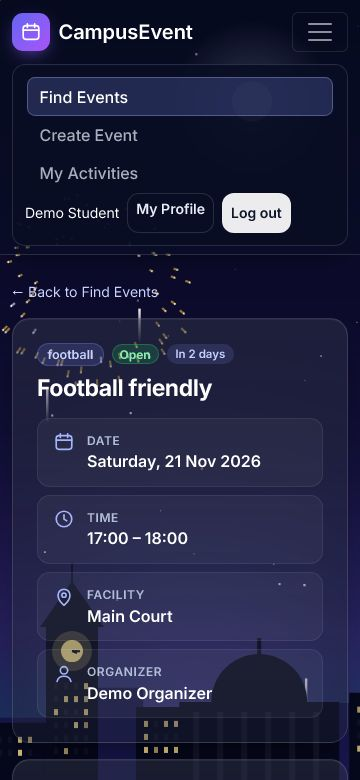 |

One column; the date tile becomes a coloured strip at the top of the card; buttons span the width; the menu collapses.

### 5.9 Error page
Unknown pages, missing rights and expired forms share one page with a short message and a way back ([screen](design/ui/15_not_found.jpg)).

## 6. Visual design system
The design is called **Glass Night**: a dark animated campus background with frosted glass surfaces. It is defined in [`_theme_glass.html`](../src/campusevent/web/templates/_theme_glass.html); the layout stays in `base.html` and Bootstrap 5.

### 6.1 Colours
| Token | Value | Use |
|---|---|---|
| Accent | gradient `#6366f1` → `#8b5cf6` → `#a855f7` | main buttons, active menu item, selected chips, pagination |
| Text | `#e8edf7`, headings `#ffffff` | body text, titles |
| Muted text | `#bcc7dc` | descriptions, meta data |
| Labels | `#b2bfd7` | small upper-case section titles, field labels in tiles |
| Surface | white 3.5–7.5 % over navy 38 %, 18 px blur | cards, forms, dialogs |
| Line | white 13 % | card borders, dividers |
| Success / open / free | `#86efac` on green 15–18 % | *Open* badge, free-time buttons, success messages |
| Warning / full | `#fde68a` on yellow 13–16 % | *Full* badge, overlap warning |
| Info / waiting | `#bae6fd` on sky 12–16 % | *Waiting for approval* badge and note |
| Danger / busy / rejected | `#fecaca` on red 12–16 % | *Rejected*, busy times, errors |

**Category colours** of the date tiles (six gradients, chosen by `common.accent`): blue `#2563eb`, teal `#0d9488`, violet `#7c3aed`, orange `#ea580c`, pink `#db2777`, green `#16a34a`, each darkening towards the bottom.

### 6.2 Type
**Inter** (400–800), with the system font as fallback. Page titles 1.7–2.3 rem, weight 800; card titles 1.1 rem, weight 650; body 1 rem; meta data 0.9 rem; section labels 0.8 rem upper case with letter spacing.

### 6.3 Shapes and spacing
Cards 1.1 rem radius, buttons 0.75 rem, chips and badges fully rounded. Buttons are at least **2.5 rem (40 px)** high. Bootstrap's spacing scale is used throughout.

### 6.4 Components
| Component | Look | Where |
|---|---|---|
| Glass card | surface, line border, soft shadow; lifts slightly on hover in lists | every page |
| Date tile | category gradient, weekday · day · month · relative day | event lists |
| Status badge | soft coloured pill (see 6.1) | lists, event page |
| Chip | rounded pill; the selected one in the accent | category shortcuts, interest tags |
| Info tile | icon, small label, value | event page |
| Note | coloured box with icon and text | waiting / rejected requests |
| Dialog | dark glass, icon, question, two buttons (keep / confirm) | cancel, withdraw |
| Icons | 23 line icons drawn inline as SVG (no extra download), hidden from screen readers | everywhere |

### 6.5 Background
An animated drawing of the **campus at night**: a clock tower with a working clock, a library dome and a lit stadium, windows that switch on and off, stars, a moon and **fireworks** over the campus. It shows that CampusEvent is about life on campus. It runs on a canvas; parts that do not move are drawn once and copied each frame, it pauses while the tab is hidden, and visitors who ask their system for reduced motion get one still picture. Three other looks (night, dusk, neon) can be chosen with the `BACKGROUND` setting.

### 6.6 Alternatives considered
The look was chosen step by step in the demo, by comparing working versions side by side:

| Question | Options tried | Chosen | Why |
|---|---|---|---|
| Light or dark | Light cards on a light page (first build), dark glass | Dark glass | The light version looked "too white" and plain; glass gives depth while text stays readable |
| Card surface | White cards, tinted cards, frosted glass | Frosted glass | Fits the dark background; contrast stays above 4.5:1 |
| Background | Abstract animations (aurora, constellation lines), campus skyline (night, dusk, neon, festival) | Campus skyline with fireworks | It shows what the app is about (events on campus) instead of a decoration without meaning |
| Date on event cards | Text line only, coloured date tile | Coloured date tile | The date is the first thing students look for; the category colour helps scanning |

The rejected backgrounds were removed from the code to keep it small; the four campus looks stay selectable.

## 7. Interaction and feedback
| Situation | Feedback |
|---|---|
| Any form is sent | The button shows a spinner and is disabled, so a double click cannot send twice |
| Successful action | Green message at the top, fades out after 6 seconds |
| Input error | Message above the form in plain words; the typed values stay |
| Busy facility time | Live warning while typing; free-time buttons; server check as the last line |
| Destructive action (cancel, withdraw) | Confirmation dialog that names the event and the consequence |
| Dates | Relative labels ("Today", "Tomorrow", "In 3 days") next to the full date, counted in Istanbul time |
| Waiting for approval | Note on the event page and a badge on My Activities; the slot is kept |
| Expired form | "Your form has expired. Please try again." instead of an error code |

### 7.1 Wording and formats
- **Language:** English on every page (`lang="en"`), like the course documents.
- **Tone:** short, friendly sentences in the second person ("Your request is sent."). No error codes or technical words on the page.
- **Buttons** start with a verb and say what happens: *Join event*, *Create event*, *Withdraw request*, *Submit a corrected request*.
- **Dates** as "20 Nov 2026" (on the event page "Friday, 20 Nov 2026"), with a relative label where it helps. **Times** in 24-hour format ("18:30"), always in Istanbul time; the services store UTC and the pages convert at the border.
- **Forms** take dates as `YYYY-MM-DD` and times as `HH:MM` through the browser's date and time pickers.

### 7.2 Empty states
An empty page never stays blank; it explains why and offers the next step:

| Page | Message | Next step |
|---|---|---|
| Find Events | "No events match your search." | *Create an event* |
| My Activities, history | "No completed events yet." | *Find an event* |
| Event Requests | "No requests are waiting." | – (new requests show up here) |
| My Profile, interests | "No interests yet. Add at least one." | type or pick a suggestion |

## 8. Accessibility, responsiveness and browsers
- **Contrast (WCAG 2.1 AA).** Every text colour was measured against the glass surface over the brightest part of the background: body text 7.5:1, muted text 5.1:1, labels 4.7:1, pills 5.9:1 (minimum 4.5:1). On the darkest part all values are above 8:1.
- **Touch targets** at least 40 px high; the *Leave* button was given the same height as the *You joined* label instead of being made smaller.
- **Forms:** every field has a visible label; icons are decorative and hidden from screen readers; the participant bar has a text alternative ("3 of 8 places taken").
- **Colour is never the only signal:** statuses are written words, and the information of a coloured date tile (the date) is written on the tile.
- **Keyboard:** native links, buttons and form fields; the reject box is a `
` element; the focus ring uses the accent colour.
- **Motion:** the background and floating effects stop when the system asks for reduced motion.
- **Responsive (NFR-01):** checked at 360 px and 1280 px (log in, sign up, Find Events, event page, Create Event, My Profile, My Activities, Event Requests); no horizontal scrolling was found.
- **Browsers (NFR-07):** automated walk-through in Firefox and WebKit (Safari's engine) at both widths, manual checks in Chromium (Chrome, Edge). A check on a real Mac or iPhone is still open.

## 9. Privacy in the interface
- Event pages and lists show **names only**; e-mail addresses never appear in pages or calendar files (NFR-05).
- Requests that are waiting or rejected are visible only to their organizer (waiting ones also to the admin on *Event Requests*); for other students they do not exist (404, BR-15).
- Availability on My Profile is private ("Your availability is private").
- The screenshots in this document use invented demo accounts and events; no real person's data is shown.
- **Third-party files.** The Inter typeface is loaded from **Google Fonts** (`fonts.googleapis.com`, `fonts.gstatic.com`) and Bootstrap from **jsDelivr**. To deliver these files, the visitor's browser contacts those servers, so Google and jsDelivr can see the visitor's IP address and the time of the visit (no account data and no page content are sent). Under KVKK (NFR-05) this is a transfer of personal data to a third party. The simplest fix is to serve the font and Bootstrap files from our own `static/` folder; then no request leaves our server. Until then, the privacy notice of the deployed site should mention it. This is listed as an open point in section 12.

## 10. From the early mockups to the final design
The [mockups of the analysis](analysis/ui/README.md) were low-fidelity and light. The built UI keeps their structure (same screens, same fields) and changes the following:

| Topic | Mockup | Final design | Reason |
|---|---|---|---|
| Look | Light, dark blue menu | Dark glass on an animated campus background | A recognisable look; users found the light version "too white" |
| Create Event | Separate availability check | Live schedule box, free-time buttons, overlap warning | Prevents the most common error (busy slot) before sending |
| Find Events | Filters only | Category shortcuts, date tiles with category colours, relative days, pagination | Faster scanning and filtering on phones |
| Join / leave | Join on the card, leave on the event page | Join and leave on the card | One click for the most frequent actions |
| Event approval | – | *Event Requests* page, waiting/rejected notes, corrected request | Change request CR-01 (UC-12) |
| Student menu | Showed *Facilities* | Role-based menus | Students cannot use the facility page (NFR-04) |
| Calendar | – | Add to calendar (.ics) | Students plan in their own calendar |
| Time range filter, *Send a new code* | Shown | Not built | The service interface has no method for them yet (see 12) |

## 11. Usability evaluation
### 11.1 Heuristic review (Nielsen's 10 heuristics)
| Heuristic | How the design meets it |
|---|---|
| Visibility of system status | Messages after every action, request states on two pages, live schedule box, spinner on buttons |
| Match with the real world | Campus words (facility, event, organizer); dates as "Tomorrow"; calendar-like date tiles |
| User control and freedom | Leave, withdraw, cancel; dialogs with a *Keep* option; *Clear all filters* |
| Consistency and standards | One card style, one colour per meaning, same menu position on every page |
| Error prevention | Free-time buttons, overlap warning, capacity range, double-submit guard, confirmations |
| Recognition rather than recall | Category list and suggestions, interest suggestions, free times shown instead of remembered |
| Flexibility and efficiency | Category shortcuts, join and leave from the list, copy link, calendar file |
| Aesthetic and minimalist design | One main action per screen; secondary actions in quieter styles |
| Help users recover from errors | Plain messages that say what to do; typed values kept; corrected request after a rejection |
| Help and documentation | Short hints in the forms (capacity range, free times, password guide) |

### 11.2 Checks done
- 98 automated UI tests (Flask test client) cover every screen, its error states and the access rules ([test section](testing/web_ui_test_section.md)).
- Automated browser walk-through in Firefox and WebKit at 1280 px and 360 px: student request, admin approve and reject, organizer view, withdraw, corrected request; no console errors, no horizontal scrolling.
- Hands-on tests in the demo during development led to several changes: the *Leave* button on the card, its red colour and height, darker section labels on the background, the moon moved away from the buttons, and a readable rejection reason.

### 11.3 Not done yet
A task-based test with students who did not build the system (for example 5 students, 3 tasks each: join an event, organize one at a busy facility, fix a rejected request) would give real usability data. It fits into the integration test week (27–29 Nov).

## 12. Open points
| Point | Why open | Next step |
|---|---|---|
| *Send a new code* (UC-01) | No service method yet | Add `AuthService.resend_code`, then a link on the verify page |
| Time range filter (UC-05) | `search_events` has no time parameter | Backend decision |
| *Upcoming* list on My Activities | No service method for joined, still open events | Backend decision |
| Remove a facility block | Not in UC-08 and not in the service | Issue #19 (Harun) |
| Real Safari (Mac, iPhone) | Only WebKit on Windows was available | Check on a team member's device |
| Inter from Google Fonts, Bootstrap from jsDelivr | Visitors' browsers contact these servers (see 9) | Serve the files from `static/` before the final delivery, or mention it in the privacy notice |

## 13. Traceability
| Screen | Use cases | NFR |
|---|---|---|
| Sign up, Verify, Log in | UC-01, UC-02 | NFR-01, NFR-03, NFR-07 |
| My Profile | UC-03 | NFR-01, NFR-05 |
| Find Events | UC-05, UC-06, UC-10 | NFR-01, NFR-02, NFR-05 |
| Event Details | UC-06, UC-10, UC-11, UC-12 (organizer) | NFR-04, NFR-05 |
| Create Event | UC-04, UC-07 | NFR-01 |
| My Activities | UC-09, UC-12 (organizer) | NFR-05 |
| Event Requests | UC-12 | NFR-04 |
| Facility Management (task 3.6) | UC-07, UC-08 | NFR-04 |
| Error page | – | NFR-04 (403 for pages of other roles) |
| All pages | – | NFR-01 (360 px and up), NFR-07 (browsers) |
